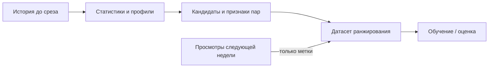

# Автоматические признаки против ручных в рекомендациях KION

Тестовое задание: можно ли заменить ручные признаки градиентного бустинга
автоматически построенными без потери качества рекомендаций.

Сделано два шага. Сначала построен сильный baseline: CatBoostRanker на 82
признаках. 54 из них считаются по истории просмотров и придуманы вручную,
например сколько раз пользователь смотрел фильмы этого жанра за 30 дней или
сколько просмотров набрал фильм за неделю.

Затем эти 54 признака заменены сгенерированными автоматически. Программа
перебирает все сочетания трёх вещей: что считать (число просмотров,
длительность, процент досмотра, тренд), по чьей истории (пользователя, фильма,
пользователя по жанру кандидата, фильма среди зрителей того же возраста и т. д.)
и за какой период (от 3 дней до всей истории). Получается 504 признака, из
которых модель отбирает 16 самых полезных. Все варианты сравниваются на одних
и тех же кандидатах, пользователях и разбиении по времени.

**Полный отчёт: [REPORT.md](REPORT.md).**

## Результаты

Итоговый тест: неделя 16–22 августа 2021 года, 11 425 активных пользователей,
до 200 кандидатов на пользователя.

| Модель | Признаков | NDCG@10 | Recall@10 | MAP@10 |
|---|---:|---:|---:|---:|
| Популярность за 7 дней | нет | 0.1366 | 0.2156 | 0.0908 |
| Baseline: 54 ручных признака по истории + 28 остальных | 82 | 0.1573 | 0.2315 | 0.1090 |
| 16 отобранных автоматических вместо 54 ручных | 44 | 0.1570 | 0.2329 | 0.1082 |
| 16 случайных из тех же 504 вместо 54 ручных | 44 | 0.1589 | 0.2337 | 0.1103 |

Остальные 28 признаков одинаковы во всех вариантах: баллы и ранги источников
кандидатов и неизменные поля пользователя и фильма (демография, жанры, год и т. п.).

- Baseline на 15% лучше популярности за 7 дней (95% CI разницы NDCG
  [+0.018; +0.024]).
- 16 автоматических признаков заменяют 54 ручных почти без потери качества:
  разница −0.0003, 95% CI [−0.0016; +0.0011]. Признаков на 46% меньше, а
  качество близкое, хотя равенство статистически не доказано.
- Отбор по важности оказался не лучше случайного выбора. Случайный контрольный
  набор выиграл на тесте. При проверке на 20 дополнительных случайных наборах
  (на прошлых данных, без теста) отобранный набор занял 8-е место из 21.
- Главное ограничение системы в кандидатах: у 27% пользователей в пуле нет ни
  одного будущего просмотра, и идеальное ранжирование пула дало бы NDCG@10 0.59.

## Задача и данные

- **Данные:** [KION](https://github.com/irsafilo/KION_DATASET), 100 000 случайных
  пользователей со всей их историей (572 621 запись).
- **Цель:** для пользователя выбрать top-10 из ещё не просмотренных фильмов.
  Позитив: просмотр в следующие 7 дней. Показов в данных нет, поэтому задача
  поставлена как ранжирование (YetiRank, NDCG@10, Recall@10, MAP@10), а не как
  предсказание клика.
- **Кандидаты:** популярность за всю историю и за 7 дней, ItemKNN и жанровый
  профиль пользователя, объединённые через RRF.

## Разбиение по времени

| История строго до | Неделя меток | Роль |
|---|---|---|
| 19 июля, 26 июля, 2 августа | следующая неделя | Обучение; поиск автоматических признаков |
| 9 августа | 9–15 августа | Валидация: параметры и сравнение вариантов |
| 16 августа | 16–22 августа | Итоговый тест, открыт один раз |



Признаки и кандидаты считаются только по записям строго раньше даты среза;
метки присоединяются после этого. Параметры и набор признаков фиксировались
до открытия теста.

## Как запустить

Нужен Python 3.14. Данные, модели и кэши (около 1,5 ГБ) в репозиторий не
входят, поэтому полный прогон обучает всё заново: около 5 часов на CPU
(2 потока, до 6 ГБ памяти).

```bash
python3.14 -m venv .venv && source .venv/bin/activate
python -m pip install -r requirements.lock
python -m pytest -q          # 39 тестов на синтетических данных, ~15 с
```

Baseline, около 2 часов:

```bash
python main.py download
python main.py prepare
python -u main.py run
python -m scripts.verify_validation
python -m scripts.freeze_validation
python main.py lock-test
python -u main.py test
python -m scripts.feature_ablation
```

Автоматические признаки, около 2 часов, и проверка случайными наборами, около 1 часа:

```bash
python -m kion_autofeatures reproduce --name reproduction_01
python -m scripts.random_subsets --name reproduction_01
```

`reproduce` пишет результаты под новым именем и не трогает опубликованные.
Если локально уже есть артефакты основного запуска, их можно проверить и
пересобрать отчёт без обучения:

```bash
python -m kion_autofeatures verify
python -m scripts.build_research_report
```

Пошаговые команды и продолжение после прерывания:
[baseline](docs/baseline_usage.md),
[автоматические признаки](docs/automatic_features_usage.md).

## Структура

| Путь | Что там |
|---|---|
| `kion/` | baseline: загрузка KION, временное разбиение, признаки, кандидаты, обучение, метрики |
| `kion_autofeatures/` | генерация автоматических признаков, их расчёт, отбор и сравнение вариантов |
| `scripts/` | абляции, проверка случайными наборами, сборка отчётов и ноутбуков |
| `tests/` | автотесты, в том числе на утечки из будущего |
| `results/` | метрики, интервалы и манифесты; без моделей и данных |
| `notebooks/` | выполненные ноутбуки: [baseline](notebooks/kion_baseline.ipynb), [автоматические признаки](notebooks/kion_research.ipynb) |
| `docs/` | [детали baseline](docs/baseline_details.md), [протокол эксперимента](docs/automatic_features_protocol.md), инструкции по запуску |

## Ограничения

- Один датасет, одна выборка пользователей и одна тестовая неделя.
- В KION хранится только последний просмотр пары, нет показов и явных
  негативов; метаданные статичны.
- Оценка только на пользователях с историей; холодный старт не оценивался.
- Тестовый результат baseline был известен до построения автоматических
  признаков. Правила их сравнения зафиксированы до тестовой оценки, но это
  слабее полностью скрытого отложенного набора.
