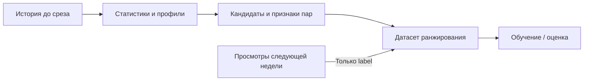

# KION: воспроизводимый baseline рекомендаций

Первая часть исследовательского задания: ручные признаки и градиентный бустинг.
Локальное обучение на CPU, фиксированная подвыборка 100 000 пользователей и временное разбиение.

## Задача и протокол

Модель ранжирует до 200 ещё не наблюдавшихся пользователем фильмов и выдаёт top-10.
Позитив — зарегистрированная пара пользователь–фильм в следующие 7 дней, независимо от
процента просмотра. Это прогноз записи о просмотре, а не CTR или удовлетворённости.
Поскольку KION не содержит журнал показов, остальные кандидаты имеют неявный label 0.
Для обучения выбран CatBoostRanker с YetiRank: цель соответствует порядку рекомендаций.

Выборка — 100 000 случайных пользователей с полной доступной историей (572 621 строка).
Три обучающих среза: 19 июля, 26 июля и 2 августа 2021 года. Валидация: 9–15 августа;
тест 16–22 августа зарезервирован для отдельного этапа. История всегда строго раньше среза.

| Срез признаков | Период labels | Назначение |
|---|---|---|
| История до 19 июля | 19–25 июля | Обучение |
| История до 26 июля | 26 июля – 1 августа | Обучение |
| История до 2 августа | 2–8 августа | Обучение |
| История до 9 августа | 9–15 августа | Выбор модели |
| История до 16 августа | 16–22 августа | Отложенный тест, этап 11 |

На каждом срезе статистики и ItemKNN пересчитываются заново по предшествующей истории.
Модель обучается на объединении первых трёх срезов; их labels заканчиваются раньше валидации.



Будущие просмотры присоединяются после построения кандидатов и признаков; они не участвуют
в их расчёте. Тестовые labels не используются на этапах 1–10.
Сетка подбирает depth ∈ {6, 8}, l2_leaf_reg ∈ {3, 10}; learning_rate=0.05, seed=42.
Обучение ограничено 5000 случайных warm-active пользователей на срез. Группы без найденного
позитива удаляются только из обучения; при оценке они остаются с нулевым качеством.
На валидации 10 852 пользователя; кандидаты отсутствующих в историческом каталоге фильмов
не генерируются, но такие цели учитываются как промахи.

## Установка

```bash
python3.14 -m venv .venv
source .venv/bin/activate
python -m pip install -r requirements.lock
python main.py --help
python main.py config
python -m pytest
```

Параметры находятся в `config.toml`; пути относительно файла конфигурации.
Метрики итогового теста на этапе выбора baseline не используются.
Данные, кэши и модели сохраняются локально и исключены из Git.

## Запуск этапов 1–10

```bash
python main.py download  # либо download --archive /path/to/data_original.zip
python main.py prepare
python -u main.py run --smoke
python -u main.py run
python -m scripts.verify_validation > results/reload_verification.json  # проверить загрузку
python -m scripts.freeze_validation  # зафиксировать завершённую валидацию
python main.py evaluate  # повторная оценка сохранённой модели на валидации
python main.py recommend --user-id 17 --k 10
```

`run` и `train` выполняют одинаковый валидационный эксперимент: три обучающих среза,
четыре конфигурации CatBoost и абляция. При отсутствии подготовленной выборки она создаётся автоматически.
`--smoke` использует отдельные кэши и результаты, 1000 пользователей и короткое обучение;
его результаты не предназначены для выбора параметров основного эксперимента.
Для длительного обучения рекомендуется `python -u`: он выводит прогресс CatBoost без буферизации,
в том числе при перенаправлении лога в файл. Полный запуск обучает четыре модели до 300 итераций
и одну абляцию. Обучение, прогнозы, подготовка Pool и численные библиотеки ограничены двумя потоками;
основной расход CPU приходится на YetiRank. Этот лимит уменьшает нагрузку, но обучение всё равно длительное.
Завершённые конфигурации сохраняются сразу: повторный `run` продолжает сетку после проверки
параметров, данных и контрольных сумм. Незавершённая конфигурация обучается заново. Абляция при повторном `run` обучается повторно;
для проверки готового результата используйте `scripts.verify_validation`, чтобы не запускать обучение.

В выполненном эксперименте первая конфигурация использует первые 300 итераций ранее обученной
модели (исходный запуск: 1500 итераций, 6 потоков). Модель не перезаписывается; поздняя история
не участвует в выборе. Для такого переноса предусмотрен `run --reuse-prefix-from artifacts/<old-run>`:
проверяются полное совпадение четырёх датасетов по SHA-256, признаки и параметры модели.
В чистом каталоге артефактов обычный `run` обучает всю сетку в текущем бюджете;
при наличии завершённых моделей он продолжает существующий эксперимент. Происхождение и затраты
перенесённой конфигурации отражены в `results/grid_provenance.json`.

Все команды на текущем этапе работают **без итоговой тестовой оценки**. Команда `recommend`
использует сохранённую модель на срезе валидации 9 августа; выдача с датой теста появится
после отдельного переобучения на этапе 11. Баллы `recommend` задают порядок выдачи и не являются вероятностями просмотра. Нулевой label — отсутствие записи в будущем периоде,
а не известный отрицательный отклик после показа.

Кэши содержат кандидатов, признаки и labels; их ключ включает конфигурацию, содержимое данных,
версии библиотек и Python, а также исходники пайплайна. Повторная оценка проверяет контрольную
сумму модели и совпадение метрик после загрузки.

Метрики усредняются по пользователям (macro). Recall использует весь будущий целевой список;
MAP@10 нормируется на `min(10, число целей)`, идеальная DCG также строится по полному списку.

Популярность, ItemKNN и RRF сравниваются на общем пуле кандидатов; при равных баллах
используется ID фильма. Все будущие позитивы остаются в знаменателях метрик, включая новые
фильмы и пропуски генератора. Ранжирование оценивается среди пользователей с прошлой историей
и хотя бы одной записью в будущем периоде, а не среди всей пользовательской базы.

Из-за предварительно агрегированного KION события привязаны к последнему просмотру пары.
Исторические признаки длительности и процента просмотра используют только строки с датой
строго раньше среза. Статические метаданные считаются доступными на дату прогноза;
их исторические версии в источнике отсутствуют. У части пользователей демография отсутствует.

Внутренняя NDCG CatBoost при early stopping нормируется по позитивам внутри кандидатов.
Кроме того, для группы без позитивных кандидатов CatBoost 1.2.10 возвращает NDCG=1;
внешняя метрика даёт 0, поскольку у пользователя есть будущие цели вне пула.
Надпись `test:` в прогрессе CatBoost обозначает переданный `eval_set` валидации 9 августа,
а не отложенную неделю 16–22 августа.
Выбор конфигурации и публикуемые результаты используют внешнюю NDCG с полным целевым списком.
Абляция убирает явные признаки связи пользователь–фильм (`pair_*`), баллы/ранги ItemKNN
и жанрового источника, а также RRF. Характеристики пользователя и фильма, популярность
и генератор кандидатов сохраняются. Технический идентификатор этой строки в CSV —
`catboost_without_personal_features`; это не полное отключение персонализации.

## План реализации

1. Окружение и конфигурация.
2. Проверенная загрузка и аудит KION.
3. Пользовательская выборка и временной протокол.
4. Исторические признаки пользователей и фильмов.
5. Генерация кандидатов и ItemKNN.
6. Персональные признаки и датасеты ранжирования.
7. Метрики и контрольные методы.
8. Обучение и выбор CatBoost.
9. Сквозной запуск и рекомендации.
10. Фиксация результатов валидации.
11. Итоговый тест (отдельный этап).
12. Отчёт и выполненный ноутбук (отдельный этап).

Описание признаков: [results/FEATURES.md](results/FEATURES.md). Завершённые результаты этапа 10: [results/VALIDATION.md](results/VALIDATION.md).
