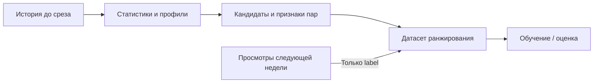

# KION: воспроизводимый baseline рекомендаций

Первая часть исследовательского задания: ручные признаки и градиентный бустинг.
Локальное обучение на CPU, фиксированная подвыборка 100 000 пользователей и временное разбиение.

Все 12 этапов завершены. [Итоговый отчёт](REPORT.md) · [Выполненный ноутбук](notebooks/kion_baseline.ipynb).
Тестовая NDCG@10 — 0.15729, прирост к заранее выбранному контролю — 15.18%.
Ноутбук содержит 13 выполненных ячеек кода; тесты — 23 passed.

## Задача и протокол

Модель ранжирует до 200 ещё не наблюдавшихся пользователем фильмов и выдаёт top-10.
Позитив — зарегистрированная пара пользователь–фильм в следующие 7 дней, независимо от
процента просмотра. Это прогноз записи о просмотре, а не CTR или удовлетворённости.
Поскольку KION не содержит журнал показов, остальные кандидаты имеют неявный label 0.
Для обучения выбран CatBoostRanker с YetiRank: цель соответствует порядку рекомендаций.

Выборка — 100 000 случайных пользователей с полной доступной историей (572 621 строка).
Три обучающих среза: 19 июля, 26 июля и 2 августа 2021 года. Валидация: 9–15 августа;
итоговый тест 16–22 августа выполнен после фиксации параметров. История всегда строго раньше среза.

| Срез признаков | Период labels | Назначение |
|---|---|---|
| История до 19 июля | 19–25 июля | Обучение |
| История до 26 июля | 26 июля – 1 августа | Обучение |
| История до 2 августа | 2–8 августа | Обучение |
| История до 9 августа | 9–15 августа | Выбор модели |
| История до 16 августа | 16–22 августа | Отложенный тест, этап 11 |

На каждом срезе статистики и ItemKNN пересчитываются заново по предшествующей истории.
Модель обучается на объединении первых трёх срезов; их labels заканчиваются раньше валидации.



Будущие просмотры присоединяются после построения кандидатов и признаков; они не участвуют
в их расчёте. Тестовые labels не используются на этапах 1–10.
Сетка подбирает depth ∈ {6, 8}, l2_leaf_reg ∈ {3, 10}; learning_rate=0.05, seed=42.
Обучение ограничено 5000 случайных warm-active пользователей на срез. Группы без найденного
позитива удаляются только из обучения; при оценке они остаются с нулевым качеством.
На валидации 10 852 пользователя; кандидаты отсутствующих в историческом каталоге фильмов
не генерируются, но такие цели учитываются как промахи.

## Установка

```bash
python3.14 -m venv .venv
source .venv/bin/activate
python -m pip install -r requirements.lock
python main.py --help
python main.py config
python -m pytest
```

Параметры находятся в `config.toml`; пути относительно файла конфигурации.
Метрики итогового теста на этапе выбора baseline не используются.
Данные, кэши и модели сохраняются локально и исключены из Git.

## Запуск этапов 1–10

```bash
python main.py download  # либо download --archive /path/to/data_original.zip
python main.py prepare
python -u main.py run --smoke
python -u main.py run
python -m scripts.verify_validation > results/reload_verification.json  # проверить загрузку
python -m scripts.freeze_validation  # зафиксировать завершённую валидацию
python main.py evaluate  # повторная оценка сохранённой модели на валидации
python main.py recommend --user-id 17 --k 10
```

`run` и `train` выполняют одинаковый валидационный эксперимент: три обучающих среза,
четыре конфигурации CatBoost и абляция. При отсутствии подготовленной выборки она создаётся автоматически.
`--smoke` использует отдельные кэши и результаты, 1000 пользователей и короткое обучение;
его результаты не предназначены для выбора параметров основного эксперимента.
Для длительного обучения рекомендуется `python -u`: он выводит прогресс CatBoost без буферизации,
в том числе при перенаправлении лога в файл. Полный запуск обучает четыре модели до 300 итераций
и одну абляцию. Обучение, прогнозы, подготовка Pool и численные библиотеки ограничены двумя потоками;
основной расход CPU приходится на YetiRank. Этот лимит уменьшает нагрузку, но обучение всё равно длительное.
Завершённые конфигурации сохраняются сразу: повторный `run` продолжает сетку после проверки
параметров, данных и контрольных сумм. Незавершённая конфигурация обучается заново. Абляция при повторном `run` обучается повторно;
для проверки готового результата используйте `scripts.verify_validation`, чтобы не запускать обучение.

В выполненном эксперименте первая конфигурация использует первые 300 итераций ранее обученной
модели (исходный запуск: 1500 итераций, 6 потоков). Модель не перезаписывается; поздняя история
не участвует в выборе. Для такого переноса предусмотрен `run --reuse-prefix-from artifacts/<old-run>`:
проверяются полное совпадение четырёх датасетов по SHA-256, признаки и параметры модели.
В чистом каталоге артефактов обычный `run` обучает всю сетку в текущем бюджете;
при наличии завершённых моделей он продолжает существующий эксперимент. Происхождение и затраты
перенесённой конфигурации отражены в `results/grid_provenance.json`.

Команды `run`, `train`, `evaluate` относятся к валидации. Итоговая оценка запускается отдельно
командой `test` по заранее зафиксированному протоколу. `recommend --stage validation` использует
модель на 9 августа, `--stage test` — итоговую модель на 16 августа; по умолчанию `auto`
выбирает итоговую модель, если её манифест уже существует. Баллы `recommend` задают порядок выдачи и не являются вероятностями просмотра. Нулевой label — отсутствие записи в будущем периоде,
а не известный отрицательный отклик после показа.

Кэши содержат кандидатов, признаки и labels; их ключ включает конфигурацию, содержимое данных,
версии библиотек и Python, а также исходники пайплайна. Повторная оценка проверяет контрольную
сумму модели и совпадение метрик после загрузки.

Метрики усредняются по пользователям (macro). Recall использует весь будущий целевой список;
MAP@10 нормируется на `min(10, число целей)`, идеальная DCG также строится по полному списку.

Популярность, ItemKNN и RRF сравниваются на общем пуле кандидатов; при равных баллах
используется ID фильма. Все будущие позитивы остаются в знаменателях метрик, включая новые
фильмы и пропуски генератора. Ранжирование оценивается среди пользователей с прошлой историей
и хотя бы одной записью в будущем периоде, а не среди всей пользовательской базы.

Из-за предварительно агрегированного KION события привязаны к последнему просмотру пары.
Исторические признаки длительности и процента просмотра используют только строки с датой
строго раньше среза. Статические метаданные считаются доступными на дату прогноза;
их исторические версии в источнике отсутствуют. У части пользователей демография отсутствует.

Внутренняя NDCG CatBoost при early stopping нормируется по позитивам внутри кандидатов.
Кроме того, для группы без позитивных кандидатов CatBoost 1.2.10 возвращает NDCG=1;
внешняя метрика даёт 0, поскольку у пользователя есть будущие цели вне пула.
Надпись `test:` в прогрессе CatBoost обозначает переданный `eval_set` валидации 9 августа,
а не отложенную неделю 16–22 августа.
Выбор конфигурации и публикуемые результаты используют внешнюю NDCG с полным целевым списком.
Абляция убирает явные признаки связи пользователь–фильм (`pair_*`), баллы/ранги ItemKNN
и жанрового источника, а также RRF. Характеристики пользователя и фильма, популярность
и генератор кандидатов сохраняются. Технический идентификатор этой строки в CSV —
`catboost_without_personal_features`; это не полное отключение персонализации.

## План реализации

1. Окружение и конфигурация.
2. Проверенная загрузка и аудит KION.
3. Пользовательская выборка и временной протокол.
4. Исторические признаки пользователей и фильмов.
5. Генерация кандидатов и ItemKNN.
6. Персональные признаки и датасеты ранжирования.
7. Метрики и контрольные методы.
8. Обучение и выбор CatBoost.
9. Сквозной запуск и рекомендации.
10. Фиксация результатов валидации.
11. Итоговое переобучение и отложенный тест.
12. Итоговый отчёт и выполненный ноутбук.

Описание признаков: [results/FEATURES.md](results/FEATURES.md). Завершённые результаты этапа 10: [results/VALIDATION.md](results/VALIDATION.md).

## Итоговая оценка — этап 11

```bash
python main.py lock-test
python -u main.py test
python main.py verify-test > results/test_reload_verification.json
python main.py recommend --user-id 17 --stage test --k 10
```

Параметры из `results/frozen_validation.json` фиксированы: depth=8, l2=3, 299 деревьев,
learning_rate=0.05, seed=42. Протокол `results/final_protocol.json` связывает их с контрольными
суммами и исходниками признаков. Контроль для первичного сравнения выбран на валидации.
В итоговое обучение добавляется срез 9 августа с тем же лимитом 5000 пользователей.
Полная модель и абляция обучаются на двух потоках, без eval_set и early stopping.
Только после сохранения обеих моделей строится тестовый срез 16 августа.

`test` сохраняет отдельные артефакты и не изменяет валидационную фиксацию. Повторный вызов
проверяет готовые результаты без переобучения. `verify-test` повторно загружает обе модели
и сверяет все тестовые баллы и метрики с допуском 1e-10. NDCG/Recall/MAP снабжены percentile
95% интервалами по 1000 bootstrap-выборкам пользователей; парные разницы используют тех же
пользователей при фиксированных моделях. Интервалы не учитывают переобучение или другую неделю.

Итоговые числа: `results/test_results.csv`; интервалы: `results/test_confidence_intervals.json`;
история, размеры данных, модели и контрольные суммы: `results/test_manifest.json`.

На отложенном тесте (11 425 warm-active пользователей) получены NDCG@10=0.15729,
Recall@10=0.23151, MAP@10=0.10896. Контроль popularity_7d: NDCG@10=0.13656;
относительный прирост 15.18%. Парная разница NDCG: +0.02074, 95% CI [0.01804; 0.02356].
Абляция: NDCG@10=0.14334. Все значения рассчитаны после фиксации параметров;
пользовательский bootstrap условен на фиксированных моделях и одной неделе.

## Отчёт и ноутбук — этап 12

```bash
python -m scripts.build_report
python -m scripts.build_notebook --execute
```

Отчёт включает постановку задачи, протокол времени, определения метрик, результаты,
парные доверительные интервалы, абляцию, диагностику кандидатов, стоимость и ограничения.
Ноутбук использует реальные сохранённые модели, проверяет все прогнозы обеих моделей,
показывает исторические признаки, кандидатов и рекомендации. Обычный повтор выполнения
не запускает обучение заново. Ядро использует Python текущего виртуального окружения,
численные библиотеки ограничены двумя потоками; рабочие файлы Jupyter — в `artifacts/`.

Полный запуск с нуля в новых каталогах результатов, включая валидацию и финальный refit:

```bash
python -m scripts.reproduce --name reproduction --full
```

Команда требует явного `--full`, создаёт `reproduction_reproduction.toml` и отдельные
`results/reproductions/reproduction`, `artifacts/reproductions/reproduction`.
Существующее имя не перезаписывается. Такой повтор требует длительного CPU-обучения;
для быстрой проверки готовых моделей достаточно `verify-test`. Техническая проверка всего
пути воспроизведения дополнительно выполнена на 1000 пользователях с коротким бюджетом;
её показатели не используются для выводов основного эксперимента.

Код фактического итогового обучения соответствует коммиту `24625fd`; точные исходники и
контрольные суммы перечислены в `results/final_execution_sources.json`. Последующее изменение
маршрута CLI `evaluate` сохраняет доступ к прежней валидационной модели после расширения проекта.

## Дополнительная проверка вклада признаков

```bash
python -m scripts.feature_ablation
python -m scripts.build_report
```

На первоначальной валидации сравниваются три варианта CatBoost: 13 сигналов источников
(`cand_*`, `rrf_score`), 69 ручных признаков (`u_*`, `i_*`, `pair_*`) и их объединение.
Две новые модели используют те же три обучающих среза, строки, кандидатов и фиксированные
параметры выбранной модели: 299 деревьев и 2 потока, без eval_set и early stopping.
Полная модель загружается из исходной валидации и заново не обучается. Новые варианты
на тесте не оцениваются; исходные результаты и модели защищены контрольными суммами.

Результаты: [feature_ablation_results.csv](results/feature_ablation_results.csv).
Парные интервалы: [feature_ablation_intervals.json](results/feature_ablation_intervals.json).
Постановка и точный состав групп: [feature_ablation_protocol.json](results/feature_ablation_protocol.json).
Проверка сохранности исходных результатов, код обучения и исходные замеры fit:
[feature_ablation_verification.json](results/feature_ablation_verification.json).
Интерпретация и замеры затрат добавлены в [отчёт](REPORT.md).

Каждое обучение и замер предсказания выполняются последовательно в отдельных процессах.
Время predict — медиана трёх повторов после прогрева на всех валидационных кандидатах;
RSS предсказания включает чтение готовых признаков и создание Pool. Стоимость генерации
кандидатов и признаков не входит в эти замеры. Для полной модели отдельные fit-время и RSS
обучения отсутствуют: сохранённое время исходного этапа включает обучение и оценку.
Повтор команды использует проверенные модели и прогнозы без обучения.

Это дополнительная диагностика на уже использованной валидации. Интервалы описательные;
новый независимый тестовый результат не заявляется. Сигналы источников также созданы вручную,
а персональный пул кандидатов сохраняется во всех вариантах. Выполненный ноутбук отражает
исходные этапы 1–12; дополнительная абляция воспроизводится отдельной командой выше.

## Вторая часть: автоматическое построение признаков

Реализована инфраструктура коммитов 15–22: декларативное пространство из 504
реляционных признаков, расчёт по истории, временной отбор, семь контролируемых
вариантов сравнения, фиксация метода и воспроизводимый запуск с ограничениями
в два потока и 6 GiB RSS. Выполнены малый реальный эксперимент (коммит 23),
основной поиск и внешняя валидация с фиксацией метода (коммит 24),
затем четыре финальных переобучения и тестовая оценка (коммит 25).

Выбраны 16 автоматических агрегатов вместо 54 ручных; вместе с сигналами
источников и статическими данными это 44 входные колонки вместо 82.
На внешней валидации NDCG@10: автоматический вариант **0.15358**, полный
baseline **0.15379**, случайные 16 агрегатов **0.15352**. Парные интервалы
разниц с baseline и случайным контролем включают ноль; превосходство
специального отбора не подтверждено, равенство качества не доказано.
На итоговом тесте NDCG@10: автоматический отбор **0.15700**, полный
baseline **0.15729**, фиксированный случайный набор **0.15887**.
Первичный интервал auto − full [-0.00157; +0.00112] включает ноль;
превосходство автоматического отбора над baseline не подтверждено.
В диагностическом сравнении выбранный набор уступил одному фиксированному
случайному набору. Метод после теста не менялся.

Тестовый протокол, качество, затраты и ограничения — в
[TEST.md](results/autofeatures/main/TEST.md). Совпадение пользователей и кандидатов,
загрузка моделей, сохранность предыдущих результатов и повторный запуск без
переобучения подтверждены в
[test_verification.json](results/autofeatures/main/test_verification.json).
Полный исследовательский отчёт и выполненный ноутбук относятся к коммиту 26.

Результаты и затраты — в [валидационном отчёте](results/autofeatures/main/VALIDATION.md).
Малый эксперимент — в [аудите ресурсов](docs/automatic_features_pilot.md).
Метод зафиксирован в [frozen.json](results/autofeatures/main/frozen.json);
проверки сопоставимости, загрузки моделей и сохранности baseline —
в [validation_verification.json](results/autofeatures/main/validation_verification.json).

Постановка и заранее выбранные правила — в [протоколе исследования](docs/automatic_features_protocol.md).
Команды, артефакты и восстановление после прерывания — в [инструкции](docs/automatic_features_usage.md).
Проверки реализации и сохранности baseline — в [implementation_checks.json](results/autofeatures/implementation_checks.json).
Тесты используют синтетические данные; их метрики не являются результатами исследования на KION.
