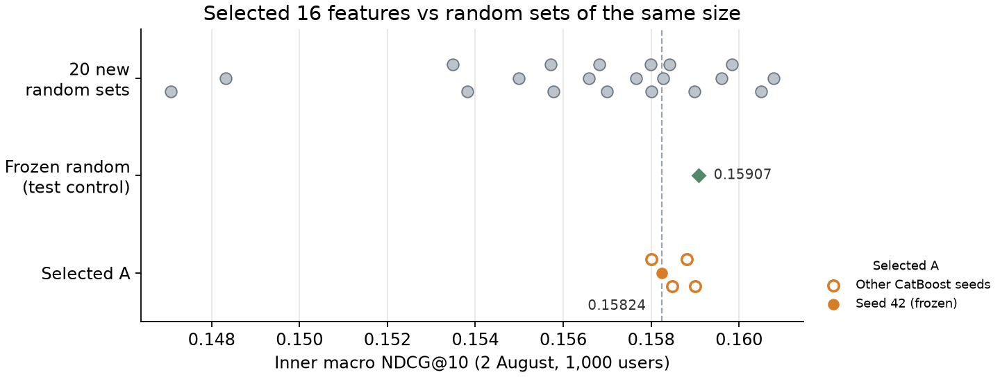

# Автоматическое построение признаков для рекомендаций KION

Вопрос задания: можно ли заменить ручные признаки градиентного бустинга
автоматически построенными без потери качества рекомендаций. Здесь проверен
один способ: признаки-агрегаты по истории просмотров генерируются перебором,
а затем отбираются по важности.

| Критерий задания | Где в отчёте |
|---|---|
| Сильный baseline без утечек | [разделы 1–3](#1-задача-и-данные); подробности в [приложении](docs/baseline_details.md) |
| Исследовательская идея: автоматические признаки | [раздел 4](#4-автоматические-признаки-генерация-и-отбор) |
| Сравнение на одном разбиении, затраты и масштабируемость | [раздел 5](#5-результаты) и [раздел 6](#6-затраты-и-масштабируемость) |
| Анализ: что сработало, что нет и почему | [раздел 5](#5-результаты) и [раздел 7](#7-выводы-и-ограничения) |

## Кратко

- **Baseline.** CatBoostRanker на 82 признаках ранжирует до 200 кандидатов.
  Тестовая NDCG@10 равна **0.15729**, это на 15.2% выше
  популярности за 7 дней (разница +0.0207, 95% CI
  [+0.0180; +0.0236]).
- **Автоматические признаки.** 16 отобранных агрегатов вместо 54 ручных
  (44 входные колонки вместо 82) дают **0.15700** против
  0.15729 у baseline. Разница -0.00030, 95% CI
  [-0.00157; +0.00112]: качество близкое, но ни превосходство,
  ни равенство не доказаны.
- **Отбор не лучше случайного.** Контрольный набор из 16 случайных агрегатов
  получил на тесте 0.15887, больше отобранного. На прошлых данных,
  без теста, отобранный набор занимает 8-е место из 21 среди
  случайных наборов того же размера.
- **Главное ограничение в кандидатах.** У 27% пользователей в пуле нет ни
  одной будущей цели; идеальное ранжирование пула дало бы NDCG@10
  0.59.

Итог: автоматически построенные агрегаты могут заменить ручные почти без
потери качества и с меньшим числом входов, но предложенный отбор находит
наборы не лучше случайных.

## 1. Задача и данные

Данные: [KION](https://github.com/irsafilo/KION_DATASET), ревизия `f69775b`.
Из 962 179 пользователей случайно выбраны 100 000 (seed 42) со всей их историей:
572 621 запись и 10 082 фильма. Полный релиз содержит 5,48 млн записей с 13 марта
по 22 августа 2021 года. Хеши архива и выборки лежат в
[sample_manifest.json](results/sample_manifest.json).

Задача поставлена как ранжирование: выбрать для пользователя top-10 из ещё не
просмотренных фильмов. Позитив означает запись о просмотре пары
пользователь–фильм в следующие 7 дней, независимо от процента досмотра. Лога
показов в KION нет, поэтому метка 0 означает «не смотрел», а не «увидел и
отказался». Отсюда YetiRank и метрики ранжирования (NDCG@10, Recall@10, MAP@10)
вместо LogLoss и ROC-AUC.

Особенность KION: каждая строка описывает пару пользователь–фильм с датой
**последнего** просмотра. Если последний просмотр пары попал в будущее, ранние
просмотры этой пары не видны. Метаданные пользователей и фильмов статичны и
считаются известными на дату прогноза.

Качество оценивается на активных пользователях: у них есть история до даты
среза и хотя бы один просмотр в следующую неделю. На тесте таких
11 425; 5 870 пользователей без истории в оценку не входят. 873 цели
приходятся на фильмы, которых не было в истории; они остаются в знаменателях
метрик как промахи.

## 2. Разбиение по времени и защита от утечек

| Срез (история строго до) | Неделя меток | Роль |
|---|---|---|
| 19 июля 2021 | 19–25 июля | Обучение; обучение при отборе признаков |
| 26 июля | с 26 июля по 1 августа | Обучение; обучение при отборе признаков |
| 2 августа | 2–8 августа | Обучение; оценка при отборе признаков |
| 9 августа | 9–15 августа | Валидация: выбор параметров и сравнение вариантов |
| 16 августа | 16–22 августа | Итоговый тест, открыт один раз |

- На каждом срезе признаки, кандидаты и ItemKNN считаются только по записям
  с датой строго раньше среза.
- Метки следующей недели присоединяются после построения кандидатов и
  признаков; функции признаков метки не принимают.
- Параметры baseline, отобранные признаки и правила сравнения зафиксированы
  до открытия теста, после теста ничего не менялось.
- Автотесты проверяют, что изменение будущих событий не меняет признаки.

На обучение берётся до 5 000 случайных активных пользователей на срез, а
агрегаты считаются по истории всех 100 000. Запросы без позитива среди
кандидатов исключаются только из обучения. Обучающая выборка для валидации
содержит 2,22 млн пар и 11 120 запросов; финальное обучение добавляет срез
9 августа, итого 2,94 млн пар и 14 704 запроса.

## 3. Baseline: кандидаты и ручные признаки

**Кандидаты.** Четыре источника: популярность за всю историю, популярность
за 7 дней, ItemKNN и жанровый профиль пользователя. Каждый предлагает до 100
фильмов. Первые 10 от каждого источника сохраняются, остальные места до 200
заполняются по RRF (k = 60). Уже просмотренные фильмы исключаются. ItemKNN
использует косинусную близость по последним 100 фильмам пользователя со
сжатием co/(co + 10) и до 100 соседей на фильм. Все варианты моделей
ранжируют один и тот же пул.

**Модель.** CatBoostRanker (YetiRank), depth=8, l2=3,
learning_rate=0.05, 299 деревьев. Параметры выбраны на валидации
по сетке depth ∈ {6, 8}, l2 ∈ {3, 10} с бюджетом 300 деревьев. В 3 из 4
конфигураций лучшая итерация пришлась на конец бюджета. У выбранной
конфигурации внутренняя NDCG за последние 50 деревьев выросла лишь на
0.0007, но больший бюджет мог бы немного улучшить baseline. В одной
конфигурации сетки взяты первые 300 деревьев более раннего запуска; выбранная
и все финальные модели обучены заново
([grid_provenance.json](results/grid_provenance.json)).

**Признаки.** 82 колонки в трёх группах:

| Группа | Колонок | Что входит |
|---|---:|---|
| S: баллы источников | 13 | баллы, ранги и флаги присутствия четырёх источников кандидатов, RRF |
| R: статические поля | 15 | демография пользователя; тип, страна, режиссёр, жанры, ID, год и возрастной рейтинг фильма |
| M: ручные агрегаты | 54 | счётчики, средняя длительность и % досмотра, давность и тренды пользователя и фильма за 7/30/90 дней и всю историю; связи пользователя с жанром, режиссёром и типом кандидата |

Определения приведены в [FEATURES.md](results/FEATURES.md). Прямых признаков
пары («сколько раз пользователь смотрел этот фильм») нет: просмотренные фильмы
исключены из кандидатов, а повторные просмотры в KION не видны. Сравнение
с популярностью и ItemKNN, абляции групп и важности признаков приведены в
[приложении](docs/baseline_details.md).

## 4. Автоматические признаки: генерация и отбор

**Идея.** Почти каждый ручной признак из M устроен одинаково: «что считать»
по «чьей истории» за «какой период». Например, число просмотров фильмов того же
жанра пользователем за 30 дней. Вместо того чтобы выбирать эти три части
вручную, программа перебирает все их сочетания, а полезные отбирает модель.
Подход близок к
[Deep Feature Synthesis](https://groups.csail.mit.edu/EVO-DesignOpt/groupWebSite/uploads/Site/DSAA_DSM_2015.pdf)
(Kanter, Veeramachaneni, 2015); идея ограничивать пространство и стоимость
поиска взята из [OpenFE](https://proceedings.mlr.press/v202/zhang23ay.html)
(Zhang et al., 2023). Сами алгоритмы этих статей не реализованы.

**Перебор даёт 504 признака**; при их построении метки не используются:

- 10 связей: история пользователя; история фильма; история пользователя по
  жанру, режиссёру, стране и типу кандидата; история фильма среди зрителей
  того же возраста, дохода, пола и признака детей.
- 8 окон: 3, 7, 10, 14, 30, 60, 90 дней и вся история.
- Операции: число просмотров, сумма и среднее log(1 + длительность), средний
  и максимальный % досмотра (400 признаков); давность последнего просмотра (10);
  доля относительно всей истории пользователя или фильма (64); тренд
  (count(короткое окно) + 1) / (count(длинное окно) + 1) для пар 3/14, 7/30
  и 10/60 дней (30).

Для жанров одна запись делится между жанрами фильма с весом 1/число жанров;
для режиссёра и страны берётся первый указанный. По смыслу перебор покрывает
43 из 54 ручных формул; не покрыты флаги пропусков, число активных дней,
разнообразие жанров и срок с первого просмотра.

**Отбор** использует только прошлые срезы, без валидации и теста:

1. 1 000 пользователей на срез: обучение на 19 и 26 июля (400 тыс. пар),
   оценка на 2 августа (200 тыс. пар).
2. Удаляются константы и точные копии колонок S, остаётся 502 признака.
3. Короткая модель (120 деревьев, depth=6) на S + R и всех 502 признаках
   ранжирует их по PredictionValuesChange на обучающих данных.
4. Первые 16, 32 и 64 признака по важности обучаются полной моделью и
   оцениваются на 2 августа. Берётся самый короткий набор в пределах 0.0001
   от лучшего.

| Число автопризнаков | NDCG@10 на 2 августа |
| --- | --- |
| 16 | 0.15824 |
| 32 | 0.15833 |
| 64 | 0.15264 |

Выбран размер 16. Контрольный случайный набор того же размера выбран заранее
(seed 42) равномерно из тех же 502 признаков. Затем все варианты сравниваются
на валидации 9 августа, метод фиксируется, и только после этого открывается
тест. Правила записаны в [протоколе](docs/automatic_features_protocol.md) до запуска.


## 5. Результаты

Варианты различаются только набором признаков; кандидаты, пользователи, метки
и параметры CatBoost одинаковы.

| Обозначение | Колонок | Состав |
|---|---:|---|
| S | 13 | только баллы источников |
| S + R | 28 | плюс статические поля |
| S + R + M | 82 | плюс 54 ручных агрегата (baseline) |
| S + R + A | 44 | плюс 16 отобранных автоматических агрегатов |
| S + R + random | 44 | плюс 16 случайных из тех же 504 автоматических признаков |

| Вариант | Колонок | NDCG@10, валидация | NDCG@10, тест | Recall@10, тест | MAP@10, тест |
| --- | --- | --- | --- | --- | --- |
| S | 13 | 0.15000 | 0.15396 | 0.22690 | 0.10641 |
| S + R | 28 | 0.15224 | 0.15639 | 0.22880 | 0.10877 |
| S + R + M | 82 | 0.15379 | 0.15729 | 0.23151 | 0.10896 |
| S + R + A | 44 | 0.15358 | 0.15700 | 0.23285 | 0.10824 |
| S + R + random | 44 | 0.15352 | 0.15887 | 0.23369 | 0.11026 |

Метрики усреднены по пользователям. Recall@10 делится на полное число будущих
целей, MAP@10 на min(10, число целей); идеальная DCG тоже строится по всем
целям, включая не попавшие в пул.

Парные разницы на тесте (bootstrap по пользователям, 1 000 повторов):

| Сравнение | ΔNDCG@10 | 95% CI: от | 95% CI: до |
| --- | --- | --- | --- |
| S + R + A − S + R + M (основное) | -0.00030 | -0.00157 | 0.00112 |
| S + R + A − S + R + random | -0.00187 | -0.00331 | -0.00042 |
| S + R + A − S | 0.00304 | 0.00163 | 0.00455 |
| S + R + A − S + R | 0.00061 | -0.00086 | 0.00207 |


- **A вместо M.** Замена 54 ручных агрегатов на 16 автоматических почти не
  меняет NDCG: интервал разницы включает ноль. Граница неухудшения заранее не
  задавалась, поэтому эквивалентность не утверждается. На валидации картина
  та же: −0.00022, 95% CI [−0.00164; +0.00118].
- **Вклад агрегатов поверх S + R не подтверждён.** S + R + A выше S + R на
  +0.00061, но интервал [-0.00086; +0.00207] включает ноль. Большую
  часть выигрыша полной модели над S даёт уже R: S → S + R +0.00243,
  S + R → S + R + M +0.00091. Без S (на валидации) ручные и
  автоматические агрегаты тоже близки: R + M 0.14108, R + A 0.14087.
- **Случайный набор выиграл у отобранного** (-0.00187, интервал ниже нуля).
  Это вторичное сравнение без поправки на множественность; основная гипотеза
  после теста не менялась.
- Интервалы учитывают только разброс по пользователям при фиксированных
  моделях и одной неделе, без разброса от переобучения и смены периода.

**Пул кандидатов.** На тесте 2,28 млн пар, recall кандидатов@200 равен 0.544.
У 3 123 пользователей (27.3%) в пул не попала ни одна цель, и для
них метрики любого ранжировщика равны нулю. Идеальное ранжирование этого пула
дало бы NDCG@10 = 0.591, так что улучшать можно и отбор
кандидатов, и порядок.

### Какие признаки выбраны

| Что считает | Окно | Имя в коде |
| --- | --- | --- |
| Фильм: тренд числа просмотров | 10 / 60 дн. | `auto__item__trend__10_60` |
| Фильм: суммарная длительность, log1p | 3 дн. | `auto__item__sum_log_dur__3` |
| Фильм: число просмотров | 3 дн. | `auto__item__count__3` |
| Фильм у зрителей того же пола: суммарная длительность, log1p | 3 дн. | `auto__item_sex__sum_log_dur__3` |
| Фильм у зрителей с тем же признаком детей: тренд числа просмотров | 10 / 60 дн. | `auto__item_kids_flg__trend__10_60` |
| Фильм у зрителей того же пола: число просмотров | 3 дн. | `auto__item_sex__count__3` |
| Фильм у зрителей того же возраста: тренд числа просмотров | 10 / 60 дн. | `auto__item_age__trend__10_60` |
| Пользователь по типу кандидата: суммарная длительность, log1p | 30 дн. | `auto__user_content_type__sum_log_dur__30` |
| Фильм у зрителей с тем же признаком детей: суммарная длительность, log1p | 3 дн. | `auto__item_kids_flg__sum_log_dur__3` |
| Пользователь по жанрам кандидата: суммарная длительность, log1p | 30 дн. | `auto__user_genres__sum_log_dur__30` |
| Пользователь по жанрам кандидата: доля просмотров | 30 дн. | `auto__user_genres__share__30` |
| Пользователь по стране кандидата: суммарная длительность, log1p | 14 дн. | `auto__user_countries__sum_log_dur__14` |
| Фильм у зрителей того же возраста: суммарная длительность, log1p | 3 дн. | `auto__item_age__sum_log_dur__3` |
| Пользователь по жанрам кандидата: суммарная длительность, log1p | 14 дн. | `auto__user_genres__sum_log_dur__14` |
| Фильм у зрителей с тем же признаком детей: число просмотров | вся история | `auto__item_kids_flg__count__all` |
| Фильм у зрителей того же пола: тренд числа просмотров | 10 / 60 дн. | `auto__item_sex__trend__10_60` |

Задание спрашивает, почему окно именно семь дней. Отбор выбрал окна, которых
нет среди ручных (7/30/90): 6 из 16 агрегатов считаются за 3 дня, ещё 4
являются трендами 10/60 дней. Половина набора описывает суммарную длительность
просмотров. Чаще всего выбраны статистики фильма, в целом и среди зрителей той
же демографии, затем жанровые предпочтения пользователя. С ручной формулой
напрямую совпадает только доля жанров за 30 дней (`pair_genre_share_30`, на
10 000 реальных пар расхождение не больше 6e-8). Режиссёров в наборе нет, но
это результат одного отбора, а не довод против таких признаков.

На A приходится 48% важности валидационной модели, на S 47%, на R 4%.
Важность делится между коррелированными колонками и не равна вкладу в качество.

### Отбор против случайных наборов того же размера

Проигрыш одному случайному набору мог оказаться случайностью. Поэтому после
теста, не трогая тестовые данные, на тех же данных, что и при отборе (обучение
19/26 июля, оценка 2 августа, 1 000 пользователей), обучены ещё 20 случайных
наборов по 16 агрегатов. Они выбраны по тому же правилу, что и контрольный,
но с другими seed. Отобранный набор дополнительно обучен с 4 другими seed
CatBoost, чтобы отделить влияние признаков от случайности обучения. Повторное
обучение отобранного набора совпало с результатом отбора до 1e-10, так что
сравнение идёт на тех же данных.

| Метрика | Отобранный A | Случайные: среднее ± sd | Случайные: диапазон | Место A | Контрольный random (место) | A на 5 seed: диапазон |
| --- | --- | --- | --- | --- | --- | --- |
| NDCG@10 | 0.15824 | 0.15648 ± 0.00362 | [0.14708; 0.16078] | 8 из 21 | 0.15907 (5 из 21) | [0.15800; 0.15900] |
| Recall@10 | 0.23142 | 0.23092 ± 0.00252 | [0.22611; 0.23595] | 8 из 21 | 0.22932 (17 из 21) | [0.22893; 0.23142] |
| MAP@10 | 0.10950 | 0.10789 ± 0.00386 | [0.09705; 0.11180] | 9 из 21 | 0.11111 (5 из 21) | [0.10950; 0.11085] |



- Отобранный набор занимает **8-е место из 21** по NDCG@10:
  7 из 20 случайных не хуже, эмпирическое p = 0.38. Средний
  случайный набор хуже на 0.00176, но интервал
  [-0.00280; +0.00589] включает ноль. Парный интервал исключает ноль в 2 сравнениях из 20, и все они в пользу отобранного набора против самых слабых случайных.
- Разброс между случайными наборами (sd 0.00362) примерно в 9 раз
  больше, чем разброс отобранного набора по seed (sd 0.00041). Выбор
  агрегатов влияет на качество, но отбор по важности использует это слабо:
  он отсекает худшие наборы, но не находит лучшие.
- Случайные наборы почти не пересекаются с отобранным (0–2 общих
  признака из 16) и при этом дают близкое качество: многие агрегаты
  взаимозаменяемы.
- Контрольный случайный набор и здесь выше отобранного (0.15907,
  5-е место из 21): на тест попал удачный, а не типичный
  случайный набор.

Ограничения проверки: 1 000 пользователей и одна неделя дают парные интервалы
около ±0.005; размер 16 выбирался на этих же данных, что скорее завышает
отобранный набор. Проверка сделана после теста и объясняет результат, но не
заменяет новый отложенный период. Результаты:
[random_subsets.json](results/autofeatures/main/random_subsets.json) и
[CSV](results/autofeatures/main/random_subsets.csv).

### NDCG@10 по сегментам пользователей на тесте

| Сегмент | Пользователей | S | S + R | S + R + M | S + R + A | S + R + random |
| --- | --- | --- | --- | --- | --- | --- |
| 1–2 фильма в истории | 2688 | 0.19893 | 0.19931 | 0.19986 | 0.20094 | 0.20158 |
| 3–9 фильмов в истории | 4321 | 0.16632 | 0.16916 | 0.16945 | 0.16846 | 0.17124 |
| 10 и больше фильмов | 4416 | 0.11449 | 0.11776 | 0.11949 | 0.11903 | 0.12076 |
| в пуле есть хотя бы одна цель | 8302 | 0.21187 | 0.21522 | 0.21646 | 0.21606 | 0.21863 |
| в пуле нет ни одной цели | 3123 | 0.00000 | 0.00000 | 0.00000 | 0.00000 | 0.00000 |

Различия между вариантами внутри сегментов малы, а интервалы по сегментам не
считались, поэтому победителя по сегментам не объявляем. У всех вариантов
качество падает с длиной истории пользователя.

## 6. Затраты и масштабируемость

Замеры на Apple M4 (16 ГБ), Python 3.14.7, CatBoost 1.2.10. Этапы шли
последовательно, в 2 потока и с лимитом памяти 6 ГБ; ни один этап не превысил лимит.

| Этап | Минуты | Пик памяти, МиБ |
| --- | --- | --- |
| Поиск признаков | 9.6 | 3289 |
| Валидация вариантов | 53.5 | 3637 |
| Финальное обучение и тест | 60.6 | 3810 |

Поиск, валидация и финальный этап для автоматических признаков заняли около
124 минут без baseline и вспомогательных проверок. Проверка
случайными наборами заняла ещё 58 минут.

| Вариант | Подготовка Pool, с | Обучение, с | Предсказание, с | Модель, МиБ |
| --- | --- | --- | --- | --- |
| S | 0.2 | 506 | 0.40 | 1.20 |
| S + R | 2.7 | 966 | 0.45 | 1.26 |
| S + R + M | нет | готовая модель | 0.54 | 1.26 |
| S + R + A | 2.7 | 1042 | 0.49 | 1.26 |
| S + R + random | 3.0 | 1040 | 0.49 | 1.26 |

- Генерация всех 504 признаков занимает 17–19 с на матрицу из 200 тыс. пар.
  32 колонки, нужные для валидации (A и random), строятся за 5,4 с на
  обучающий срез и 14,6 с на 2,17 млн оценочных пар. Это время добавляется
  к построению кандидатов и признаков S и R.
- Признаков на 46% меньше, но модель того же размера и предсказывает почти так
  же быстро: число и глубина деревьев не меняются. Меньшее число колонок не
  делает дешевле весь конвейер.
- Время предсказания измерено как медиана трёх прогонов на готовой тестовой
  матрице из 2,28 млн пар, без построения кандидатов и признаков. Полная модель
  переиспользована, её исходное обучение заняло 1049 с вместе с Pool.

Признаки считаются группировками по истории и проецируются на пары батчами по
20 тыс., полная матрица пользователь × фильм не строится. Стоимость растёт
с числом событий, жанров на фильм, окон и пар-кандидатов. Для миллиардов
событий нужны инкрементальные агрегаты или хранилище признаков; это, как и
задержка онлайн-сервиса, здесь не проверялось.

## 7. Выводы и ограничения

1. Baseline на ручных признаках построен без утечек и на 15% лучше
   популярности за 7 дней.
2. Автоматически сгенерированные агрегаты могут заменить ручные: 16 отобранных
   дают близкое качество при 44 входах вместо 82.
3. Предложенный отбор по важности не лучше случайного выбора из тех же
   признаков: 8-е место из 21 на прошлых данных и проигрыш контрольному
   набору на тесте. Пользу приносит сам перебор, а не отбор.
4. Главное ограничение системы в кандидатах: у 27% пользователей
   в пуле нет ни одной цели, и это ограничивает любой ранжировщик.

Что проверить дальше, с новым протоколом и новым отложенным периодом: отбор
с учётом корреляции признаков (например, жадное добавление по приросту качества,
как в OpenFE), отбор на нескольких прошлых срезах, распределение случайных
контролей на валидации, улучшение кандидатов. Текущий тест для подбора больше
использовать нельзя.

**Ограничения.** Один датасет, одна выборка пользователей, один seed отбора и
одна тестовая неделя. Хранится только последний просмотр пары, нет показов
и явных негативов, метаданные статичны, оценка только на активных
пользователях. Тестовый результат baseline был известен до построения
автоматических признаков; правила их сравнения зафиксированы до тестовой
оценки, но это слабее полностью скрытого отложенного набора. Офлайн-метрики
не гарантируют прироста CTR или удержания.

**Проверки.** Все 12 моделей валидации и теста повторно загружаются и дают те же
прогнозы и метрики (atol 1e-10); порядок пар, схемы признаков и контрольные
суммы артефактов сверяются, файлы baseline не менялись. Выполненный
[ноутбук](notebooks/kion_research.ipynb) не обучает моделей: он проверяет все
сохранённые модели и пересчитывает агрегаты на реальной истории, в том числе
при искажённых будущих событиях. Автотесты на синтетических данных проверяют
граничные случаи и утечки.

## 8. Воспроизведение

Окружение: Python 3.14.7, CPU, точные версии в `requirements.lock`. Данные,
модели и кэши (около 1,5 ГБ) в Git не хранятся, поэтому на новой машине нужен
полный прогон, около 5 часов CPU: baseline около 2 ч, автоматические признаки
около 2 ч, проверка случайными наборами около 1 ч.

```bash
python3.14 -m venv .venv && source .venv/bin/activate
python -m pip install -r requirements.lock
python -m pytest -q

python main.py download
python main.py prepare
python -u main.py run
python -m scripts.verify_validation
python -m scripts.freeze_validation
python main.py lock-test
python -u main.py test
python -m scripts.feature_ablation

python -m kion_autofeatures reproduce --name reproduction_01
python -m scripts.random_subsets --name reproduction_01
```

`reproduce` повторяет все шаги автоматических признаков под новым именем и не
трогает опубликованные результаты. Повторная оценка на том же тесте проверяет
воспроизводимость, но нового независимого эксперимента не даёт. Если
артефакты основного запуска уже есть локально, их можно проверить без обучения:

```bash
python -m kion_autofeatures verify
python -m scripts.build_research_report
python -m scripts.build_research_notebook --execute
```

Пошаговые команды и продолжение после прерывания описаны в
[инструкции](docs/automatic_features_usage.md), подробности baseline в
[приложении](docs/baseline_details.md). Промежуточные записи эксперимента:
[валидация](results/autofeatures/main/VALIDATION.md),
[тест](results/autofeatures/main/TEST.md).
