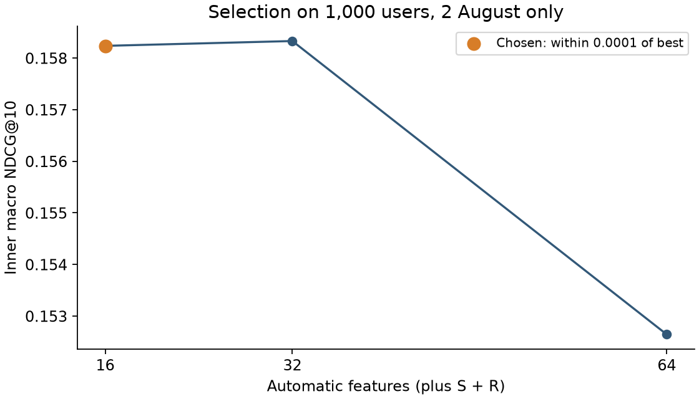
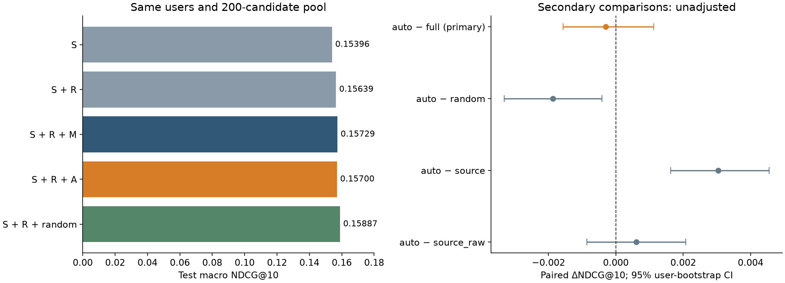

# KION: ручные и автоматически построенные признаки рекомендаций

## Результат исследования

Построен воспроизводимый двухступенчатый рекомендатель: исторические источники
дают до 200 кандидатов, CatBoostRanker выбирает top-10. Полный baseline с 82
ручными входными колонками достигает NDCG@10 **0.15729**,
на **15.18%** выше заранее выбранной популярности за 7 дней.
Во второй части реализованы генератор реляционных временных агрегатов и их
отбор на отдельном внутреннем временном разбиении. 16 автоматических агрегатов
заменяют 54 ручных агрегата; полный вход уменьшается с 82 до 44 колонок.

Автоматический вариант получил **0.15700** на тесте.
Первичное Δ auto − full = **-0.00029741**, 95% CI
**[-0.00156854; +0.00111813]**. Превосходство не подтверждено;
равенство и неухудшение также не доказаны: граница неухудшения заранее не задавалась.
Один заранее фиксированный случайный набор такого же размера получил
**0.15887** и превзошёл выбранный набор в диагностическом сравнении.
Это содержательный отрицательный результат для конкретного способа отбора,
одного seed и одной недели. После теста метод не менялся.

## 1. Данные и смысл задачи

Источник — [KION_DATASET](https://github.com/irsafilo/KION_DATASET), ревизия
`f69775be31fa5779907cf0a92ddedb70037fb5ae`; хеш архива и подготовленной выборки
находится в [sample_manifest.json](results/sample_manifest.json).
Из 962 179 пользователей равномерно выбраны 100 000 (seed=42), сохранена вся
их доступная история: 572 621 строка, 10 082 фильма. Исходный релиз содержит
5 476 251 строку и 15 706 фильмов; фактические даты — 13 марта — 22 августа 2021.

В KION одна строка соответствует паре пользователь–фильм с **последней** датой
просмотра. Это не полный журнал повторных просмотров: ранние просмотры пары,
последняя дата которой попала в будущее, восстановить нельзя. Предсказывается
наличие записи пары в следующей неделе, независимо от watched_pct. Метка 0
обозначает отсутствие записи, а не известный отказ после показа. Лога показов нет.
Статические метаданные считаются доступными на дату среза; их версий во времени нет.

Оценка условна на warm-active пользователях: есть историческая запись и хотя бы
одна целевая запись следующей недели. Это задача ранжирования для активной
аудитории, не оценка удержания, cold start или качества на всей базе.
На тесте 11 425 таких пользователей; 5 870 cold-active пользователей исключены.
873 цели тёплых пользователей относятся к новым фильмам и остаются в знаменателях.

## 2. Временной протокол и baseline

| Срез | Будущие метки | Роль |
|---|---|---|
| 19 июля 2021 | 19–25 июля | Обучение baseline; обучение внутреннего поиска |
| 26 июля | 26 июля – 1 августа | Обучение baseline; обучение внутреннего поиска |
| 2 августа | 2–8 августа | Обучение baseline; оценка внутреннего поиска |
| 9 августа | 9–15 августа | Внешняя валидация всех вариантов |
| 16 августа | 16–22 августа | Итоговый тест |

В каждый срез история ограничена строго датами `< cutoff`. Кандидаты и признаки
строятся до присоединения labels. До 5 000 обучающих пользователей случайно
выбираются на дату, но агрегаты используют историю всей фиксированной когорты.
Группы без найденного позитива исключены только из обучения; в оценке остаются.
Валидационное обучение: 2 223 979 пар / 11 120 запросов. Финальное обучение
включает также срез 9 августа: 2 940 779 пар / 14 704 запроса.

Источники: общая популярность, популярность за 7 дней, ItemKNN и жанровый профиль.
Каждый даёт до 100 кандидатов; сохраняются до 10 от каждого, остальное заполняет
RRF с константой 60 до общего лимита 200. Уже наблюдавшиеся пары исключаются;
будущие позитивы принудительно не добавляются. ItemKNN использует бинарную
историю до 100 последних фильмов, cosine × co/(co+10), до 100 соседей на фильм.
Все варианты ранжируют одинаковые упорядоченные пары и полные цели.

CatBoostRanker: YetiRank, depth=8, L2=3, learning_rate=0.05, seed=42,
max_ctr_complexity=1. Параметры baseline выбраны из сетки depth={6,8}, L2={3,10}
на внешней валидации, бюджет до 300 деревьев; для сравнений зафиксированы 299.
Финальные переобучения используют четыре прошлых среза без eval_set/early stopping.
В начальной сетке одна конфигурация переиспользовала проверенные первые 300 деревьев
старого запуска (1500 деревьев, 6 потоков); выбранная модель и финальные запуски
обучались заново в два потока. Происхождение отражено в
[grid_provenance.json](results/grid_provenance.json).

Внутренняя NDCG CatBoost нормируется по позитивам в кандидатах и используется
для early stopping baseline; внешний выбор конфигурации использует полные цели.
При нулевых позитивных кандидатах внешняя NDCG равна нулю, хотя внутренняя
метрика CatBoost 1.2.10 для такой группы возвращает 1.

## 3. Гипотезы и контролируемые группы признаков

| Семейство | Размер | Содержание |
|---|---:|---|
| S | 13 | Баллы, ранги, индикаторы четырёх источников и RRF |
| R | 15 | Статические поля пользователей/фильмов, ID, числовые поля и missing flags |
| M | 54 | Ручные исторические агрегаты пользователей, фильмов и связей пары |
| A | 16 | Автоматически сгенерированные и отобранные исторические агрегаты |
| random | 16 | Один случайный набор из той же грамматики; фактически без пересечений с A |

Первичный вопрос: меняется ли NDCG при замене M на A при фиксированных S и R?
Контроль S+R отделяет вклад новых агрегатов от статических данных. Сравнение
с random проверяет пользу специального отбора сверх самого словаря агрегатов.
Размер random, seed=42 и способ выбора зафиксированы до теста.

Диагностика без S на валидации: R+M (69 колонок) получила 0.14108188,
R+A (31 колонка) — 0.14086861. Кандидаты при этом остаются персональными;
это не система без рекомендательных источников. Ранняя абляция с 45 колонками
в первом отчёте исключает другую группу полей и не подменяет этот контроль.
Часть S и все источники кандидатов тоже спроектированы вручную: автоматизируется
построение семейства агрегатов M, а не весь рекомендательный конвейер.

## 4. Генерация и отбор

Идея обхода связей и применения агрегирующих операций опирается на
[Deep Feature Synthesis (Kanter, Veeramachaneni, 2015)](https://groups.csail.mit.edu/EVO-DesignOpt/groupWebSite/uploads/Site/DSAA_DSM_2015.pdf).
[OpenFE (Zhang et al., ICML 2023)](https://proceedings.mlr.press/v202/zhang23ay.html)
предлагает оценивать дополнительную пользу признаков через feature boosting
и сокращать кандидатов в два этапа. Здесь заимствована мотивация ограничить
пространство и стоимость поиска; реализован более простой importance-based
screen с временной оценкой префиксов. Feature boosting OpenFE и рекурсивный
синтез произвольной глубины DFS не реализованы. Полученные числа не являются
репликацией результатов этих статей или их оценкой на KION.

Грамматика задаёт 504 признака без просмотра меток. 10 путей: история пользователя
и фильма; история пользователя по жанру/режиссёру/стране/типу кандидата; история
фильма по возрасту/доходу/полу/kids_flg текущего пользователя. Окна: 3, 7, 10, 14,
30, 60, 90 дней и вся история. Пять операций (count, sum/mean log1p(duration),
mean/max watched_pct) дают 400 признаков, recency — 10, share — 64,
trend для пар окон 3/14, 7/30, 10/60 — 30.

`trend=(count(short)+1)/(count(long)+1)`. Share — отношение совпавшего
взвешенного числа записей к родительскому. Пустые count/sum равны 0,
mean/max/recency — NaN; share с пустым знаменателем равен 0. Для жанров
историческая запись распределяется с весом 1/число жанров, проекция на жанры
кандидата усредняется; mean имеет знаменатель только по непустым значениям.
Max/recency используют любое совпадение. Для режиссёра/страны берётся первый
элемент по той же нормализации, что у baseline. Это явные ограничения грамматики.

Для внутреннего поиска выбраны 1000 целых пользовательских запросов на дату,
история когорты сохранена. Обучение на 19/26 июля (400 тыс. пар), оценка на
2 августа (200 тыс. пар); 243 запроса без позитивов в пуле остаются в оценке.
На внутреннем обучении удалены два точных дубликата S: item count за 7 дней
и всю историю. Осталось 502 признака. Screen-модель (120 деревьев, depth=6)
ранжирует их по PredictionValuesChange **на обучении**. Это ранжирование
важности, не отдельная проверка качества. Префиксы 16/32/64 оцениваются
фиксированным ranker на внутреннем отложенном срезе:

| Число A | Внутренняя NDCG@10 |
| --- | --- |
| 16 | 0.15823607 |
| 32 | 0.15832946 |
| 64 | 0.15264288 |

Выбран минимальный префикс в пределах 0.0001 от лучшего: 16. Случайный контроль
выбран равномерно без возвращения из 502 допустимых признаков; в данном наборе
пересечений с A не оказалось. Внешняя валидация только сравнивает
семь фиксированных вариантов; метод затем запечатан в
[frozen.json](results/autofeatures/main/frozen.json), seal `8aa5502a0eba5ec202350035db8243174d70c3f845901c27f37821c0a7c5e956`.
Правила заранее описаны в [протоколе](docs/automatic_features_protocol.md).



## 5. Качество и интерпретация

| Вариант | Колонок | Val NDCG@10 | Test NDCG@10 | Test Recall@10 | Test MAP@10 |
| --- | --- | --- | --- | --- | --- |
| S | 13 | 0.14999998 | 0.15395937 | 0.22689983 | 0.10641211 |
| S + R | 28 | 0.15223658 | 0.15638651 | 0.22879640 | 0.10876941 |
| S + R + M | 82 | 0.15379418 | 0.15729445 | 0.23151415 | 0.10896146 |
| S + R + A | 44 | 0.15357914 | 0.15699704 | 0.23285430 | 0.10823508 |
| S + R + random | 44 | 0.15352174 | 0.15886812 | 0.23368790 | 0.11025592 |

Метрики macro по пользователям. Recall использует полное число будущих целей;
MAP@10 делится на min(10, число целей); идеальная DCG также использует полный
целевой набор. На тесте общие 2 284 830 пар кандидатов. Candidate Recall@200 =
**0.54366744**; у 3 123 пользователей (27.33%) ни одной цели в пуле, у всех
ранжировщиков метрики для них равны нулю. Oracle NDCG при идеальном ранжировании
этого пула — **0.59105**: улучшать можно и retrieval, и порядок.

Полный baseline выше популярности за 7 дней (0.13655864): ΔNDCG=+0.02073581,
95% CI [+0.01803895; +0.02355715]. Дополнительная старая абляция full−S на
валидации даёт +0.00379420, но включает и R, и M. Новый S+R показывает,
что нельзя целиком приписывать этот выигрыш ручным историческим агрегатам.

Парные разности тестовой NDCG:

| Сравнение | ΔNDCG | 95% lower | 95% upper |
| --- | --- | --- | --- |
| auto − full (primary) | -0.00029741 | -0.00156854 | 0.00111813 |
| auto − random | -0.00187108 | -0.00330963 | -0.00041510 |
| auto − source | 0.00303767 | 0.00162722 | 0.00455348 |
| auto − source_raw | 0.00061053 | -0.00085700 | 0.00207195 |

Percentile bootstrap: 1000 повторов одних и тех же пользователей, seed=42.
Первичное сравнение — auto−full. Остальные диагностические, без поправки на
множественные сравнения. Интервалы условны на обученных моделях и одной неделе,
не учитывают вариацию переобучения, seed, выборки или следующего периода.



Автогенерация даёт конкурентную точечную оценку при меньшем числе входных полей.
Однако дополнительная NDCG сверх S+R на тесте не подтверждена: соответствующий
интервал пересекает ноль. Прибавка auto над S включает также влияние R.
Выбранный набор проиграл одному случайному контролю по NDCG и MAP в
диагностических интервалах. Это не доказывает универсальную пользу случайного
поиска. У random самая высокая точечная NDCG среди пяти вариантов; первичная
гипотеза не заменяется на random−full после просмотра теста.

На внешней валидации auto−full=-0.00021504, CI [-0.00163593; +0.00118246],
auto−random=+0.00005740 с интервалом, включающим ноль. Валидационный почти
нулевой разрыв не обещал преимущества отбора на следующей неделе.

### Что выбрано и что из этого следует

| Выбранный агрегат | Семантический аналог в M |
| --- | --- |
| auto__item__trend__10_60 | — |
| auto__item__sum_log_dur__3 | — |
| auto__item__count__3 | — |
| auto__item_sex__sum_log_dur__3 | — |
| auto__item_kids_flg__trend__10_60 | — |
| auto__item_sex__count__3 | — |
| auto__item_age__trend__10_60 | — |
| auto__user_content_type__sum_log_dur__30 | — |
| auto__item_kids_flg__sum_log_dur__3 | — |
| auto__user_genres__sum_log_dur__30 | — |
| auto__user_genres__share__30 | pair_genre_share_30 |
| auto__user_countries__sum_log_dur__14 | — |
| auto__item_age__sum_log_dur__3 | — |
| auto__user_genres__sum_log_dur__14 | — |
| auto__item_kids_flg__count__all | — |
| auto__item_sex__trend__10_60 | — |

В наборе 8 сумм log-duration, 4 trend, 3 count и 1 share; 6 агрегатов используют
3 дня, 4 — отношение 10/60, 3 — 30 дней, 2 — 14 дней, 1 — всю историю.
Часто выбраны статистики фильма в целом и по демографии, затем жанровые
предпочтения пользователя. Отсутствие режиссёров в A означает результат
данного отбора, а не доказанную бесполезность этого пути.
Только `user_genres share 30` непосредственно совпадает с ручной формулой;
проверка на 10 000 реальных пар дала max abs error 5.96e-8. Вся грамматика
покрывает 43 из 54 ручных формул по смыслу, но не missing flags, active_days,
разнообразие и observed_age; средние и пропуски могут иметь другую семантику.
Полные определения A и random — в [CSV](results/autofeatures/main/selected_features.csv).

Доля A в PredictionValuesChange валидационной модели — 48.25%, S — 47.36%,
R — 4.38%. При коррелированных колонках важность распределяется между ними;
это не причинный эффект и не 48% дополнительного качества.
Возможные объяснения проигрыша random: коррелированные краткосрочные статистики
получили высокую обучающую важность, внутренние 1000 пользователей и одна неделя
дали нестабильный отбор. Более разнообразный random мог оказаться удачным.
Это гипотезы: компонентных абляций и повторных случайных наборов здесь нет.

### Сегменты

| variant | segment | users | ndcg@10 | recall@10 | map@10 |
| --- | --- | --- | --- | --- | --- |
| source | history_1_2 | 2688 | 0.19893036 | 0.30311249 | 0.14399346 |
| source | history_3_9 | 4321 | 0.16632373 | 0.24703921 | 0.11661385 |
| source | history_10_plus | 4416 | 0.11448737 | 0.16080338 | 0.07355423 |
| source | retrieval_zero_hits | 3123 | 0.00000000 | 0.00000000 | 0.00000000 |
| source | retrieval_some_hits | 8302 | 0.21187495 | 0.31225374 | 0.14644162 |
| source_raw | history_1_2 | 2688 | 0.19931331 | 0.30024109 | 0.14495685 |
| source_raw | history_3_9 | 4321 | 0.16915958 | 0.24894563 | 0.11992006 |
| source_raw | history_10_plus | 4416 | 0.11775888 | 0.16559255 | 0.07583150 |
| source_raw | retrieval_zero_hits | 3123 | 0.00000000 | 0.00000000 | 0.00000000 |
| source_raw | retrieval_some_hits | 8302 | 0.21521512 | 0.31486375 | 0.14968568 |
| auto | history_1_2 | 2688 | 0.20094340 | 0.30529586 | 0.14555031 |
| auto | history_3_9 | 4321 | 0.16846445 | 0.25164317 | 0.11836134 |
| auto | history_10_plus | 4416 | 0.11902637 | 0.17037477 | 0.07561304 |
| auto | retrieval_zero_hits | 3123 | 0.00000000 | 0.00000000 | 0.00000000 |
| auto | retrieval_some_hits | 8302 | 0.21605531 | 0.32044813 | 0.14895035 |
| random | history_1_2 | 2688 | 0.20158463 | 0.30536233 | 0.14627843 |
| random | history_3_9 | 4321 | 0.17124054 | 0.25351941 | 0.12110459 |
| random | history_10_plus | 4416 | 0.12076051 | 0.17065510 | 0.07771390 |
| random | retrieval_zero_hits | 3123 | 0.00000000 | 0.00000000 | 0.00000000 |
| random | retrieval_some_hits | 8302 | 0.21863024 | 0.32159530 | 0.15173138 |
| full | history_1_2 | 2688 | 0.19986004 | 0.30340547 | 0.14474024 |
| full | history_3_9 | 4321 | 0.16945053 | 0.25109732 | 0.11950749 |
| full | history_10_plus | 4416 | 0.11949039 | 0.16859234 | 0.07686391 |
| full | retrieval_zero_hits | 3123 | 0.00000000 | 0.00000000 | 0.00000000 |
| full | retrieval_some_hits | 8302 | 0.21646460 | 0.31860386 | 0.14994997 |

Это описательные оценки: отдельных доверительных интервалов и проверки гипотез
по сегментам нет. Нельзя объявлять победителя для конкретной аудитории по этим точкам.

## 6. Вычислительные затраты и масштабирование

Измерения на Apple M4, 16 GB RAM, Python 3.14.7, CatBoost 1.2.10; версии всех
зависимостей зафиксированы в requirements.lock. Тяжёлые запуски последовательны,
ограничены двумя вычислительными потоками и 6 GiB суммарного RSS дерева процессов.

| Этап | Минуты | Peak tree RSS, МиБ | Превышен лимит |
| --- | --- | --- | --- |
| search | 9.61 | 3288.6 | False |
| validate | 53.49 | 3636.9 | False |
| test | 60.63 | 3810.4 | False |

Итого поиск, внешняя валидация и финальный этап заняли около
123.7 измеренных минут, без первого baseline,
пилота и последующих проверок. Это время сохранённых запусков, не обещание
длительности на другом компьютере и не календарная длительность с паузами сна.
Пилот на 1000 пользователях занял 22.30 с / 863.9 МиБ, с существенно меньшим
бюджетом модели; линейно переносить его время на основной эксперимент нельзя.

| Вариант | Train Pool, с | Fit, с | Predict, с | Модель, байт |
| --- | --- | --- | --- | --- |
| S | 0.223 | 506.24 | 0.405 | 1256984 |
| S + R | 2.682 | 965.90 | 0.451 | 1316540 |
| S + R + M | — | готовая модель | 0.539 | 1317352 |
| S + R + A | 2.722 | 1042.37 | 0.494 | 1319076 |
| S + R + random | 2.965 | 1040.20 | 0.495 | 1318612 |

Predict — медиана трёх прогретых пакетных вызовов на готовой тестовой матрице,
2.285 млн пар; retrieval, генерация признаков и Pool в него не входят.
Для полного baseline модель переиспользована, первоначальный fit занял 1049.38 с
вместе с Pool. Этот исторический замер не является синхронным сравнением fit.
RSS вариантов внутри одного рабочего процесса зависит от состояния аллокатора;
сравнивать его как изолированный расход памяти моделей нельзя.

Полная грамматика генерировалась на трёх внутренних матрицах по 200 тыс. пар:
17–19 с на матрицу. Объединение 32 колонок A/random для внешней валидации
строилось за 5.4 с на каждый обучающий срез и 14.64 с на 2.17 млн оценочных пар
(около 54 МиБ parquet). Эти расходы добавляются к уже построенным кандидатам
и S/R. Количество входов уменьшилось на 46.3%, но сериализованный auto даже
чуть больше full: число деревьев и структура сохраняются. Уменьшение числа
полей не доказывает меньшую память или ускорение всего конвейера.

Грамматика конечна, расчёты используют исторические группировки и проекции
на батчи пар (20 тыс.), а не полный user×item. Рост пользователей/фильмов,
жанровых разверток, числа окон и числа candidate-пар увеличивает память и
стоимость. До масштабирования нужны замеры на нескольких размерах, отдельные
процессные benchmark и инкрементальные агрегаты/хранилище признаков. Здесь
не измерены serving latency, QPS и распределённая обработка, не заявлена
готовность для миллиардов событий.

## 7. Надёжность, ограничения и соответствие заданию

Выполнены обе практические части: сильный classical ML baseline, собственная
реализация автоматических признаков, временной внутренний поиск, контроли,
сопоставимые кандидаты/пользователи/цели, зафиксированный финальный тест,
проверки утечки, повторная загрузка моделей, затраты и воспроизведение.
Это реализация и исследование автоматизации признаков, без заявления о новом
универсальном алгоритме или научной новизне самой идеи агрегирования.

Все 12 финальных/валидационных моделей проверены загрузкой, повторными
прогнозами и метриками (atol=1e-10). Схемы, параметры, 299 деревьев, порядок
пар и checksum артефактов проверены; исходные файлы baseline сохранены.
Повторный вызов финального этапа занял 1.03 с без изменения моделей и fit receipts.
Выполненный [ноутбук](notebooks/kion_research.ipynb) запрещает fit, проверяет
все модели, пересчитывает агрегаты на реальной истории для одного примера
и проверяет неизменность результата при искажении будущих значений.
Автотесты отдельно проверяют синтетические граничные случаи и утечки.

Ограничения: один датасет, одна когорта, seed и тестовая неделя; один random;
last-watch формат, отсутствие экспозиций и настоящих негативов; статические
метаданные; warm-active оценка; заранее известный тестовый результат baseline.
Правила новых моделей зафиксированы до их тестовой оценки, но это слабее
полностью скрытого от исследователя holdout. Bootstrap по пользователям не
исправляет эти ограничения и не доказывает онлайн-эффект.

Содержательный вывод: словарь автоматически построенных агрегатов способен
дать близкую точечную оценку, но выбранная схема importance-based отбора
не доказала пользу сверх random и не подтвердила прибавку NDCG к S+R на тесте.
Дальнейшие проверки — несколько прошлых временных folds, несколько seed/random
контролей, отбор с учётом корреляции и стоимости — требуют нового протокола
и нового отложенного периода. Повторное использование этого теста для настройки
превратит его в development-набор. Новых вариантов после теста здесь не обучали.

## 8. Как проверить и воспроизвести

### Быстрая проверка готовых артефактов, без обучения

```bash
source .venv/bin/activate
python -m pytest -q
python -m kion_autofeatures verify
python -m scripts.build_research_report
python -m scripts.build_research_notebook --execute
```

Ноутбук запускает полную проверку моделей; это десятки секунд на данной машине.
Генератор останавливается при отсутствии готовых артефактов, обучения по fallback нет.
Монитор RSS включает kernel и завершает собственное дерево процессов при превышении.
Запуск kernel требует разрешения на локальные соединения и наблюдение процессов.

### Полное воспроизведение на новой машине

```bash
python3.14 -m venv .venv
source .venv/bin/activate
python -m pip install -r requirements.lock
python main.py download
python main.py prepare
python main.py run
python -m scripts.verify_validation
python -m scripts.freeze_validation
python main.py lock-test
python main.py test
python -m scripts.feature_ablation
python -m kion_autofeatures reproduce --name reproduction_01
```

Численные версии и Python входят в identity. Данные, модели и кэши не хранятся
в Git; для быстрой проверки их нужно воспроизвести или перенести с сохранением
checksum. `reproduce` повторяет вторую часть с новым именем, включая подбор
внутри прошлого времени; это проверка воспроизводимости, а не новый независимый
holdout. Для другого имени отчёты стадий поддерживают `--name`; итоговый отчёт
и ноутбук по умолчанию используют основной run из autofeatures.toml.
Исходные замороженные результаты не перезаписывать. Изменённая ревизия кода
или окружение требуют нового согласованного набора артефактов.

Подробности команд и продолжения после прерывания:
[инструкция](docs/automatic_features_usage.md). Отчёт первой части сохранён
в [REPORT.md](REPORT.md), выполненный baseline-ноутбук —
[kion_baseline.ipynb](notebooks/kion_baseline.ipynb).
Промежуточные записи исследования: [валидация](results/autofeatures/main/VALIDATION.md),
[тест](results/autofeatures/main/TEST.md),
[аудит теста](results/autofeatures/main/test_verification.json).
Машинная сводка этого отчёта: [summary.json](results/autofeatures/main/report/summary.json).
