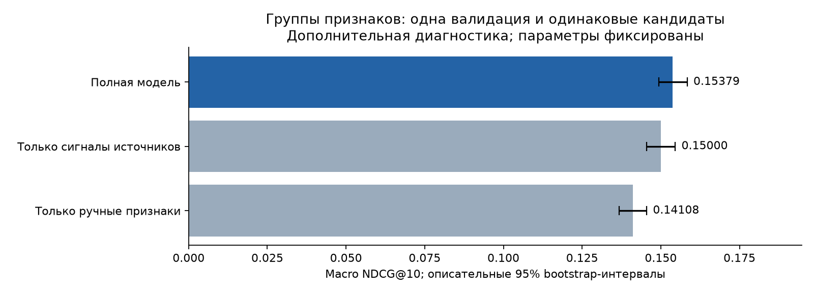
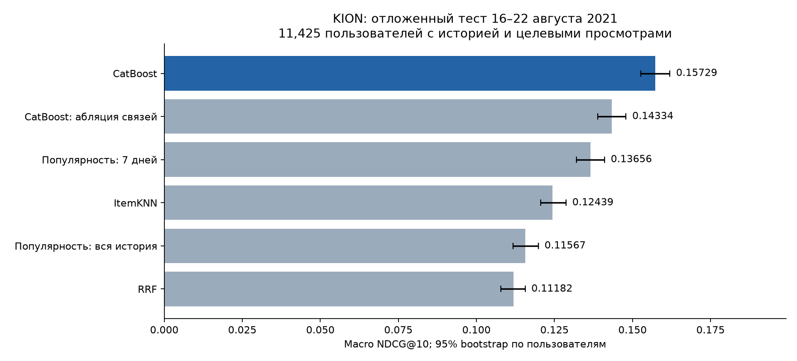
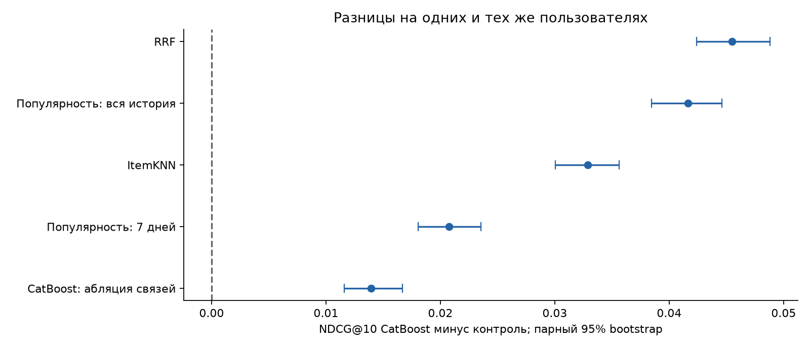

# Детали baseline: ручные признаки и CatBoost

Приложение к [основному отчёту](../REPORT.md): данные, кандидаты, подбор параметров, абляции, итоговый тест и затраты baseline.

На тесте NDCG@10 = **0.15729**, Recall@10 = **0.23151**, MAP@10 = **0.10896**. Это на 15.18% выше основного контроля (популярность за 7 дней): разница +0.02074, парный 95% CI [+0.01804; +0.02356]. Интервал целиком выше нуля.

## Данные и задача

Источник: [KION](https://github.com/irsafilo/KION_DATASET/tree/f69775be31fa5779907cf0a92ddedb70037fb5ae), коммит `f69775be`, полный архив `data_original.zip` (SHA-256 в [sample_manifest.json](../results/sample_manifest.json)). Размер архива: записей 5 476 251, пользователей 962 179, фильмов 15 706; даты с 2021-03-13 по 2021-08-22.
Случайно (seed 42) выбрана когорта пользователей (100 000), их история сохранена полностью (записей: 572 621). Демографии нет у части пользователей полного архива (217 891); для них в признаках стоит значение «нет данных». Метаданные статичны и считаются известными на дату среза.

Цель: рекомендовать top-10 из фильмов, которых пользователь ещё не смотрел. Метка 1 означает запись о просмотре пары пользователь–фильм в следующие 7 дней, независимо от процента досмотра. Метка 0 означает отсутствие записи, а не отказ после показа: показов в KION нет. Поэтому выбраны YetiRank и метрики ранжирования, а не LogLoss или ROC-AUC.

**Особенность данных.** Строка хранит только последний просмотр пары. Если он попал в будущее, ранние просмотры той же пары не видны в истории, хотя сами признаки считаются строго по времени.

Оцениваются пользователи с историей до среза и хотя бы одним просмотром в следующую неделю, так что это не оценка удержания всей базы. Новые пользователи в оценку не входят; для них CLI выдаёт популярное, но качество такой выдачи не измерялось.

## Разбиение по времени и защита от утечек

| История строго до | Неделя меток | Роль |
|---|---|---|
| 19 июля | 19–25 июля | Обучение |
| 26 июля | с 26 июля по 1 августа | Обучение |
| 2 августа | 2–8 августа | Обучение |
| 9 августа | 9–15 августа | Выбор параметров, затем добавлен в итоговое обучение |
| 16 августа | 16–22 августа | Итоговый тест, оценивается один раз |

Кандидаты и признаки строятся до присоединения меток. На каждом срезе статистики, профили и ItemKNN используют только записи с датой строго раньше среза. Автотесты проверяют, что изменение будущих событий не меняет признаки и что тестовый срез не попадает в обучение.
До открытия теста зафиксированы параметры (YetiRank, depth=8, l2=3, 299 деревьев, learning_rate=0.05, seed=42), основной контроль (популярность за 7 дней), bootstrap на 1000 повторов и абляция ([final_protocol.json](../results/final_protocol.json)). После этого по тесту ничего не подбиралось.
Обе итоговые модели обучены на четырёх срезах без `eval_set`, early stopping и выбора числа деревьев по тесту; тестовый срез строится только после их сохранения. На каждом срезе берутся до 5000 случайных активных пользователей. Запросы без позитива среди кандидатов исключаются только из обучения, в оценке они остаются с нулём.

| Срез итогового обучения | Пользователей | Пар | Позитивов среди кандидатов |
|---|---|---|---|
| 2021-07-19 | 3 762 | 752 400 | 6 844 |
| 2021-07-26 | 3 667 | 733 387 | 6 600 |
| 2021-08-02 | 3 691 | 738 192 | 6 828 |
| 2021-08-09 | 3 584 | 716 800 | 6 475 |

## Кандидаты и признаки

Четыре источника: популярность за всю историю, популярность за 7 дней, ItemKNN и жанровый профиль пользователя. Каждый предлагает до 100 фильмов; первые 10 от каждого сохраняются, остальные места до 200 заполняются по RRF (k = 60). Просмотренные фильмы исключены, будущие позитивы в пул принудительно не добавляются.
ItemKNN строится по бинарным взаимодействиям с последними 100 фильмами пользователя: косинусная близость со сжатием `co / (co + 10)`, до 100 соседей на фильм. Жанровый источник умножает жанровый профиль пользователя на недавнюю популярность фильма. Каталог ограничен фильмами, которые встречались до среза.
82 признака: характеристики пользователя и фильма; число просмотров, средняя длительность и % досмотра, давность и тренды за 7/30/90 дней и всю историю; связи пользователя с жанром, режиссёром и типом кандидата; баллы и ранги источников. ID пользователя в модель не передаётся, ID фильма передаётся как категория. Определения: [FEATURES.md](../results/FEATURES.md).
Абляция удаляет признаки связи пользователя с кандидатом (`pair_*`), баллы и ранги ItemKNN и жанрового источника (`cand_knn_*`, `cand_genre_*`) и `rrf_score`; остаётся 45 признаков. Характеристики пользователя и фильма и персональный пул кандидатов при этом сохраняются, так что это проверка явных связей, а не полное отключение персонализации.

## Выбор на валидации

Сетка: depth ∈ {6, 8}, l2 ∈ {3, 10}, learning_rate = 0.05, до 300 деревьев. Конфигурация выбирается по macro NDCG@10 со всеми будущими целями. Число деревьев внутри конфигурации определяет внутренняя NDCG CatBoost: она нормируется только по позитивам в пуле и для запросов без позитивов равна 1, поэтому с внешней NDCG напрямую не сравнима.

| Метод | NDCG@10 | Recall@10 | MAP@10 |
|---|---|---|---|
| Популярность за всю историю | 0.11659 | 0.16893 | 0.08154 |
| Популярность за 7 дней | 0.13089 | 0.20122 | 0.08856 |
| ItemKNN | 0.12746 | 0.18693 | 0.08806 |
| RRF | 0.10988 | 0.17848 | 0.07062 |
| CatBoost | 0.15379 | 0.22415 | 0.10759 |
| CatBoost без признаков связи | 0.13705 | 0.20264 | 0.09548 |

Выбраны depth=8, l2=3, 299 деревьев. Две лучшие конфигурации различаются на валидации всего на 0.000124 NDCG, так что преимущество глубины 8 не доказано.
В первой конфигурации сетки взяты первые 300 деревьев более раннего запуска на 1500 деревьев (6 потоков); в выборе участвовали только они. Происхождение: [grid_provenance.json](../results/grid_provenance.json). Выбранная конфигурация и обе финальные модели обучены заново в 2 потока.

## Абляция групп признаков на валидации

После фиксации baseline обучены две дополнительные модели: только на сигналах источников и только на ручных признаках. Полная модель взята из исходной валидации, её прогнозы воспроизведены. Новые модели на тесте не оценивались; исходные модели, тестовые результаты и протокол не менялись.

Во всех вариантах те же три обучающих среза (пар 2 223 979, запросов 11 120) и те же валидационные пользователи (10 852). Параметры полной модели не менялись: depth=8, l2=3, learning_rate=0.05, seed=42, 299 деревьев, 2 потока, без eval_set и early stopping.

**Сигналы источников (13):** все `cand_*` (баллы, ранги и флаги присутствия четырёх источников кандидатов) и `rrf_score`; в основном отчёте это группа S. **Ручные признаки (69):** все `u_*`, `i_*`, `pair_*`. Колонки групп не пересекаются, но информация частично дублируется: популярность фильма есть и как балл источника, и как счётчик. Сигналы источников тоже придуманы вручную, так что здесь сравниваются два ручных представления, а не ручное и обученное.

| Вариант | Признаков | NDCG@10 | Recall@10 | MAP@10 |
|---|---|---|---|---|
| Только сигналы источников | 13 | 0.15000 | 0.22070 | 0.10405 |
| Только ручные признаки | 69 | 0.14108 | 0.20765 | 0.09833 |
| Полная модель | 82 | 0.15379 | 0.22415 | 0.10759 |



Полная модель против модели на сигналах источников: ΔNDCG = +0.00379 (+2.53%), парный 95% CI [+0.00225; +0.00521]. Ручные признаки улучшают модель поверх сигналов источников.
Полная модель против модели на ручных признаках: ΔNDCG = +0.01271, 95% CI [+0.01049; +0.01474]. Это совместный эффект добавленной группы, а не вклад отдельных признаков.

13 сигналов источников работают лучше 69 ручных признаков: дело не в числе колонок. Ручные признаки полезны прежде всего как дополнение к сигналам в полной модели.
Ручные признаки против сигналов источников: ΔNDCG = -0.00892, 95% CI [-0.01138; -0.00652].

Bootstrap: 1000 повторов по одним и тем же пользователям, seed = 42. Эта валидация уже использовалась для выбора полной модели, поэтому интервалы описательные и без поправки на множественность. Независимой тестовой проверки новых вариантов они не заменяют.

| Вариант | Обучение, с | Память при обучении, МиБ | Предсказание, с | Память при предсказании, МиБ | Модель, МиБ |
|---|---|---|---|---|---|
| Только сигналы источников | 381.5 | 1222.9 | 0.444 | 706.5 | 1.20 |
| Только ручные признаки | 801.6 | 3138.5 | 0.563 | 2118.6 | 1.26 |
| Полная модель | не измерено | не измерено | 0.580 | 2402.5 | 1.28 |

Обучение: время самого вызова fit, без построения Pool. Память при обучении: пик отдельного процесса, который читает признаки, строит Pool и обучает модель. Предсказание: медиана трёх вызовов на всей валидации после прогрева, без построения Pool. Память при предсказании измерена в отдельном процессе для каждого варианта: чтение признаков, загрузка модели, Pool и predict. Это пакетный замер, а не задержка сервиса.
Полная модель заново не обучалась. Исходный этап fit, predict и оценки занимал 898.4 с: обучено 300 деревьев, сохранено 299. Время и память именно её обучения тогда отдельно не измерялись, поэтому в таблице их нет.
Все варианты используют один персональный пул и готовый кэш признаков; построение кандидатов и признаков в замеры не входит. Модель без сигналов источников всё равно получает кандидатов от ItemKNN и жанрового источника, так что экономия на всей системе здесь не оценивалась.

**Вывод для автоматических признаков:** заменять или строить автоматически стоит семейства `u_*`, `i_*`, `pair_*` при тех же кандидатах и истории, а сравнивать и с полной моделью, и с моделью только на сигналах источников.

Воспроизведение: `python -m scripts.feature_ablation`. Готовые модели и результаты проверяются по контрольным суммам и используются повторно. Протокол и результаты: `results/feature_ablation_protocol.json`, `results/feature_ablation_results.csv`, `results/feature_ablation_intervals.json`, `results/feature_ablation_manifest.json`.

## Итоговый тест

История до 2021-08-16, горизонт 7 дней, 11 425 активных пользователей с историей; 5 870 новых пользователей в оценку не входят. Пар кандидатов: 2 284 830.
Все методы ранжируют один и тот же пул. Цели вне пула и новые фильмы остаются в знаменателях, ничьи разрешаются по ID фильма. Метрики усреднены по пользователям; Recall@10 делится на все будущие цели, MAP@10 на min(10, число целей), идеальная DCG строится по полному списку.

| Метод | NDCG@10 | 95% CI NDCG | Recall@10 | MAP@10 | Recall кандидатов |
|---|---|---|---|---|---|
| Популярность за всю историю | 0.11567 | [0.11173; 0.11982] | 0.16447 | 0.08128 | 0.54367 |
| Популярность за 7 дней | 0.13656 | [0.13203; 0.14103] | 0.21561 | 0.09080 | 0.54367 |
| ItemKNN | 0.12439 | [0.12064; 0.12870] | 0.18570 | 0.08396 | 0.54367 |
| RRF | 0.11182 | [0.10782; 0.11559] | 0.18008 | 0.07170 | 0.54367 |
| CatBoost | 0.15729 | [0.15258; 0.16196] | 0.23151 | 0.10896 | 0.54367 |
| CatBoost без признаков связи | 0.14334 | [0.13893; 0.14791] | 0.21687 | 0.09834 | 0.54367 |





Полная модель против абляции: ΔNDCG = +0.01396, 95% CI [+0.01158; +0.01669]. Это совместный эффект удалённой группы признаков при тех же кандидатах и параметрах.
Основной контроль (популярность за 7 дней) выбран на валидации; остальные сравнения вторичные и без поправки на множественность. Bootstrap: 1000 выборок пользователей с возвращением, seed = 42. Модели фиксированы, поэтому интервалы не учитывают разброс от переобучения, состава обучающей выборки и смены недели и ничего не говорят об онлайн-эффекте.

## Что ограничивает качество

Recall кандидатов@200 = 0.5437: у 3 123 из 11 425 пользователей (27.3%) в пул не попала ни одна цель, и любое ранжирование даёт им ноль. При идеальном порядке имеющихся кандидатов NDCG@10 была бы 0.59105. Значит, улучшать можно и генерацию кандидатов, и порядок внутри пула.

| Сегмент | Метод | Пользователей | NDCG@10 | Recall@10 |
|---|---|---|---|---|
| 1–2 фильма в истории | Популярность за 7 дней | 2688 | 0.18085 | 0.28910 |
| 1–2 фильма в истории | CatBoost | 2688 | 0.19986 | 0.30341 |
| 1–2 фильма в истории | CatBoost без признаков связи | 2688 | 0.19093 | 0.29168 |
| 3–9 фильмов в истории | Популярность за 7 дней | 4321 | 0.14584 | 0.23535 |
| 3–9 фильмов в истории | CatBoost | 4321 | 0.16945 | 0.25110 |
| 3–9 фильмов в истории | CatBoost без признаков связи | 4321 | 0.15396 | 0.23521 |
| 10 и больше фильмов | Популярность за 7 дней | 4416 | 0.10052 | 0.15158 |
| 10 и больше фильмов | CatBoost | 4416 | 0.11949 | 0.16859 |
| 10 и больше фильмов | CatBoost без признаков связи | 4416 | 0.10398 | 0.15340 |
| в пуле нет ни одной цели | Популярность за 7 дней | 3123 | 0.00000 | 0.00000 |
| в пуле нет ни одной цели | CatBoost | 3123 | 0.00000 | 0.00000 |
| в пуле нет ни одной цели | CatBoost без признаков связи | 3123 | 0.00000 | 0.00000 |
| в пуле есть хотя бы одна цель | Популярность за 7 дней | 8302 | 0.18793 | 0.29672 |
| в пуле есть хотя бы одна цель | CatBoost | 8302 | 0.21646 | 0.31860 |
| в пуле есть хотя бы одна цель | CatBoost без признаков связи | 8302 | 0.19726 | 0.29845 |

Ниже важность PredictionValuesChange итоговой модели. Она показывает влияние признака на предсказания, а не причинный вклад; коррелированные признаки делят важность между собой.

| Признак | Важность |
|---|---|
| cand_knn_score | 16.450 |
| cand_knn_rank | 13.981 |
| i_count_7 | 9.490 |
| cand_recent_score | 6.894 |
| i_trend_7_30 | 5.950 |
| cand_recent_rank | 5.571 |
| cand_pop_rank | 3.634 |
| cand_pop_score | 3.615 |
| i_count_all | 2.833 |
| rrf_score | 2.448 |
| i_total_dur_mean | 2.320 |
| i_watched_pct_mean | 2.286 |

## Вычислительные затраты

| Модель | Пар | Запросов | Признаков | Деревьев | Обучение, с |
|---|---|---|---|---|---|
| CatBoost | 2 940 779 | 14 704 | 82 | 299 | 1049.4 |
| CatBoost без признаков связи | 2 940 779 | 14 704 | 45 | 299 | 1178.1 |

Весь финальный этап занял 37.6 мин, пик памяти 3983 МиБ, 2 потока, Apple M4 с 16 ГБ. Параметр CatBoost `used_ram_limit=6gb` ограничивает только сам CatBoost, а не весь процесс. Время валидационной сетки сюда не входит.
Кандидаты и признаки строятся батчами, совместная встречаемость для ItemKNN считается блоками, полная матрица пользователь × фильм не строится. Обучающая таблица и Pool CatBoost держатся в памяти, их размер растёт как число запросов × лимит кандидатов × число признаков. Совместная встречаемость ItemKNN может дорого расти на плотных каталогах. CLI рекомендаций пересчитывает профили и ItemKNN при каждом вызове; для онлайн-сервиса нужны кэш профилей и индекса, регулярное обновление и замер задержки.

## Ограничения

Одна случайная выборка пользователей, одна тестовая неделя, ограниченное число обучающих запросов и небольшая сетка гиперпараметров. Формат последнего просмотра, неявные негативы, статичные метаданные и оценка только активных пользователей ограничивают выводы. Офлайн-прирост не гарантирует прироста CTR, удержания или выручки.
Для сравнения альтернатив baseline зафиксирован: им нужны те же срезы, кандидаты и доступная информация, а их параметры выбираются на обучении и валидации до тестовой оценки. Если тест использовать для итеративного выбора моделей, для независимого вывода понадобится новый отложенный период.

## Воспроизведение и файлы

Python 3.14.7, точные версии в `requirements.lock`, CPU. Данные и модели в Git не хранятся; их пути и контрольные суммы перечислены в манифестах.

Проверка готового результата без обучения:

```bash
python main.py verify-test
python main.py recommend --user-id 17 --stage test --k 10
python -m scripts.build_report
python -m scripts.build_notebook --execute
```

Полное переобучение в отдельные каталоги, чтобы не перезаписать опубликованный тест:

```bash
python -m scripts.reproduce --name reproduction --full
```

Команда повторяет валидационную сетку и оба финальных обучения. Повторная оценка того же теста проверяет воспроизводимость, но нового независимого эксперимента не даёт.

[Выполненный ноутбук](../notebooks/kion_baseline.ipynb) использует сохранённые модели и данные: проверяет артефакты и прогнозы, показывает признаки, кандидатов, подбор и итоговую оценку. Модели в нём не обучаются.

Финальная модель, её SHA-256 и размеры данных лежат в [test_manifest.json](../results/test_manifest.json), исходники запуска в [final_execution_sources.json](../results/final_execution_sources.json) (Git-коммит обучения `24625fd`). Зафиксированные параметры и интервалы: [frozen_validation.json](../results/frozen_validation.json), [test_confidence_intervals.json](../results/test_confidence_intervals.json).
